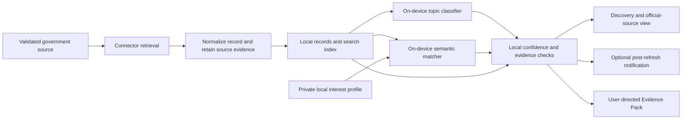

# CivicWindow application build plan

**Status:** Proposed application composition and delivery sequence, grounded in the CivicWindow master pitch and slide deck v1.3. No application code, build, connector, model, schema, test run, or device result is claimed here. This document does not select final libraries, model packages, supported jurisdictions, or release dates.

**Source snapshot:** `CivicWindow_Master_Pitch_v1.3.md` (SHA-256 `d6d7b60461d315f53303c797c68326f2d71659ce524e51af6a86bfe8943e7748`), `CivicWindow_Pitch_v1.3.pptx` (SHA-256 `c04bb2eb78aa7730fd8a56741bf8d2e3f30995771b25e1b76ac761261d9f2140`), and `CivicWindow_Speaker_Notes_v1.3.md` (SHA-256 `8f4872009cc8808357d89353cb86dd288041fdef8b156241b351ae4e74760b79`) are in the separate COS359 planning workspace. The deck has 13 slides; slides 12–13 are references. This plan uses the pitch's product commitments and the v0.6/v0.7 repository boundaries, while leaving their source files unchanged.

## Product to build

A resident chooses supported municipal or state jurisdictions and keeps an interest profile on the Android device. Validated connectors retrieve public records when the network is available. The app normalizes and stores those records locally, classifies their civic topics and matches them to the resident's interests with on-device models. The user sees matched records with source status, dates, excerpts and official links, and may request a JSON or Markdown Evidence Pack. Optional notifications follow successful retrieval and matching when Android and the user permit them. The app shows the last successful refresh and offers manual refresh.

Core use requires no mandatory account, recurring subscription or hosted AI inference service. New records and initial model acquisition require connectivity. Offline search and matching apply to records already downloaded. A source check can verify that displayed material corresponds to a retrieved record; it cannot establish that the government's record is correct, that a proposal passed, or that every relevant item was found. These boundaries come from the master pitch §§Executive summary, Slides 3, 6–8 and deck slides 3, 6–8. See [product requirements](../product/REQUIREMENTS.md) and [data flow](DATA_FLOW.md).

## Proposed application composition

The diagram is a proposed data path, not a claim that every action runs simultaneously. Classification and matching retain their model identity and uncertainty. Source identity, original links, retrieval state and timestamps travel with the normalized record. A failed fetch, empty successful result, stale local data, missing model and uncertain match require distinct presentation states. See [system architecture](SYSTEM_ARCHITECTURE.md), [AI boundary](../../modules/ai/ARCHITECTURE.md), [Android boundary](../../modules/android/ARCHITECTURE.md) and [data boundary](../../modules/data/ARCHITECTURE.md).

The existing 14 feature directories express ownership areas. They do not imply 14 Gradle modules or a completed dependency graph. The Android host in `app/` composes accepted implementations through versioned shared interfaces. Normal role work uses accepted pinned cross-role inputs; controlled substitutes support isolated checks only. Full integration uses the real selected implementations. See [module dependencies](MODULE_DEPENDENCIES.md) and [repository overview](REPOSITORY_TECHNICAL_OVERVIEW.md).

## Category A core build map

The master pitch §Slide 8 and deck slide 8 define these ten core outcomes. The proof column below proposes reviewable evidence; exact thresholds, fixtures and supported devices still require approval. No row is currently implemented.

| Pitch feature | Primary source area and role | Proposed proof before calling the feature built |
|---|---|---|
| 1. Account-free private onboarding | `modules/android/onboarding/`, Android/Product | A new user reaches discovery without an account; any local data created by onboarding has a defined deletion path. |
| 2. Manual jurisdiction selection | `modules/android/jurisdictions/`, Android/Product | The UI shows only validated supported jurisdictions and persists the user's selection locally. Unsupported coverage is not advertised. |
| 3. Multi-jurisdiction retrieval | `modules/data/legistar/`, `modules/data/state-legislative/`, `connectors/`, Data/Platform | At least two approved jurisdiction sources yield repeatable records with source IDs, links, retrieval status and failure cases. Exact source set is decided through access validation. |
| 4. Local persistence and offline search | `modules/data/local-storage/`, `app/`, Data/Platform and Android/Product | Downloaded records can be searched and opened without a network connection; the interface distinguishes last successful refresh from current data. |
| 5. Private interest profiles | `modules/android/interests/`, Android/Product | A user can create and change locally held interests, and the matching boundary consumes the agreed profile contract. Storage and deletion behavior are reviewed. |
| 6. Custom civic classification | `modules/ai/civic-classifier/`, `ml/`, AI/ML | A fine-tuned classifier emits documented topic labels, numeric confidence and model provenance against reviewed held-out examples; physical-device loading and inference are measured. |
| 7. On-device semantic matching | `modules/ai/semantic-matcher/`, `modules/ai/inference-runtime/`, AI/ML | Downloaded records and private interests can be ranked locally; relevance evaluation and physical-device cost are reported against agreed baselines. |
| 8. Evidence-linked discovery | `modules/android/discovery/`, `modules/android/evidence/`, Android/Product | A result separates source text from model inference and exposes official links, relevant dates, excerpts and uncertainty. Broken or mismatched evidence is handled visibly. |
| 9. Optional refresh-based notifications | `modules/android/notifications/`, `app/`, Android/Product with Data/Platform | Notifications occur only after successful retrieval and matching when enabled and permitted; denied permission, delayed background work, failed refresh and manual refresh are exercised. |
| 10. Portable Evidence Pack | `modules/android/evidence-export/`, Android/Product | A user-directed JSON or Markdown export contains selected record metadata, jurisdiction, source links, retrieval information, excerpts and labeled model outputs or uncertainty. |

A passing substitute test proves only the isolated case it exercised. Core completion also needs real producer/consumer contracts, integrated application behavior and relevant physical-device checks. See [test strategy](../testing/TEST_STRATEGY.md).

## Later product scope and geographic boundary

**Category B growth:** Additional jurisdictions/connectors; structured entity, action and deadline extraction; document change and version history; advanced PDF/OCR; advanced geographic and entity filtering. **Category C enhancement:** Optional compact on-device reasoning; multilingual classification/discovery; community-contributed connectors; richer evidence comparison. These are pitch §Slide 8 and deck slide 9 items 11–19. They remain outside the Category A completion claim unless a later approved plan selects them.

The pitch's ten-city list is a research pool, not confirmed support. The release objective of four to six municipalities plus one state legislative source is conditional on validated access and capacity. Category A still requires a working multi-jurisdiction implementation. A source requiring unplanned OCR does not count as a completed structured-text core connector. The exact supported set and course calendar must be fixed during feasibility planning; a required reduction of the course-approved Category A scope needs instructor resolution rather than a silent move to Month 3.

## Technology and model candidates from the pitch

| Layer | Pitch proposal | Decision or evidence still needed |
|---|---|---|
| Android interface | Kotlin and Jetpack Compose | Supported Android, Kotlin and Compose versions; accessibility and screen designs |
| Local records and interests | Room / SQLite with local full-text indexing | Schema, migrations, retention, deletion and offline query behavior |
| Background retrieval | WorkManager with network constraints and retries | Device behavior, permission states, refresh status and non-guaranteed timing |
| Government sources | Validated municipal sources, Legistar-compatible endpoints where available, and one state legislative source | Terms, format, authentication, rate limits, repeatable access and jurisdiction choice |
| Mobile inference | LiteRT or ONNX Runtime Mobile | Model compatibility, package size, latency, memory and battery measurements |
| Civic classification | ModernBERT Base candidate, fine-tuned for civic taxonomy | License, reviewed labels, held-out results, conversion and device feasibility |
| Semantic relevance | EmbeddingGemma 2 text-only candidate | Retrieval quality, adaptation need, runtime support and device cost |
| Later extraction/reasoning | Category B extraction; Category C optional Qwen3 0.6B candidate | Benefit, cost and separate acceptance before inclusion |

These are proposals from master pitch §§Slides 6–7 and deck slides 6–7. No runtime, model, version or external source is approved merely by appearing in this table. Source APIs provide records; they are not hosted AI inference. The application must keep core inference and interests local if it is to satisfy the pitch's product claim.

The pitch targets **at least 10,000 usable historical records for acquisition**, subject to access, deduplication, text quality and rights review. It does not claim 10,000 labeled examples. The AI/ML path must define a taxonomy, review weak labels, count usable supervised pairs, establish a held-out split that avoids near-duplicate leakage, evaluate classification and retrieval against baselines, and measure converted models on physical devices. Low-confidence outputs need explicit uncertainty behavior. See [AI decisions](../ai-ml/README.md) and [ML asset tree](../../ml/README.md).

## Stepwise build and evidence route

The pitch's five project-relative months are a planning sequence. **Category A is due by the end of Month 2 of Software Architecture**, whose calendar date is not yet mapped here. Month 3 is for hardening and selected growth, not the first core delivery. Each step below names evidence required to advance; it does not assert that the evidence exists.

1. **Prove feasibility and choose the core slice.** Validate source terms and repeatable retrieval for a municipal and state candidate; select the supported jurisdiction set; test representative records and label mapping; verify access to a physical Android device; benchmark candidate model loading. Record failed sources and fallback choices.
2. **Define shared contracts and demonstrate one vertical path.** Review civic record, source evidence, interest, classifier and relevance semantics with producers and consumers. Show a real retrieved record normalized, stored, surfaced with an official link and matched locally where feasible. Keep model and source substitutions explicit during partial development.
3. **Develop Category A across the three role lanes.** Data/Platform supplies accepted record and evidence inputs; AI/ML supplies evaluated model and result contracts; Android/Product builds the user flow. Each lane declares its own build inputs and verifies interfaces. An unfinished ticket remains isolated so independent completed work can proceed.
4. **Compose the actual core candidate.** Select exact source revisions, approved dependencies and model artifacts. Run real contract, integration and offline/refresh scenarios. A role-only pass or a candidate containing unrelated blocked work cannot stand in for this result.
5. **Validate the Month 2 core on devices.** Demonstrate all ten Category A outcomes, including model loading, inference, offline search, retrieval recovery, evidence inspection, notification permission handling and export. Record device, input, source and result identities plus unresolved limitations. If scope or timing cannot meet the course milestone, escalate the proposed change through the course decision process.
6. **Harden and prepare later delivery.** After the core milestone, fix measured defects, add selected Category B work when capacity permits, run the Month 4 formal test scenarios, then bind a distributable Month 5 build to an exact release source and evidence record. Store publication remains a separate decision.

The supported toolchain, executable build commands, sparse role profiles, CI workflows and output packaging belong in [build profiles](../operations/BUILD_PROFILES.md) and [release process](../operations/RELEASE_PROCESS.md) once they can be verified. This plan does not make an empty Gradle file or placeholder CI run a passing build.

## Staffing and repository fit

Pitch v1.3 named a person for the AI/ML Engineer role and left the other positions open. The project has since been selected and the three leads assigned. The pitch permits three to five contributors. The repository design currently uses three permanent role branches: AI/ML, Android/Product and Data Integration/Platform. In the three-person plan, the leads share quality, review and release duties. Additional contributors can perform those functions within the same role lanes; staffing alone does not create a new permanent branch or expand product scope. See [repository overview](REPOSITORY_TECHNICAL_OVERVIEW.md) and [ownership and coverage](../operations/OWNERSHIP_AND_COVERAGE.md).

## Evidence and open-decision ledger

| Product or build claim | Source basis | Current state and next proof |
|---|---|---|
| Core user path and local inference | Master pitch §§Slides 3, 6–8; deck slides 3, 6–8 | Proposed only; integrated source-to-device demonstration required |
| Ten Category A features and Month 2 course milestone | Master pitch §Slide 8; deck slide 8; [feature list](../product/FEATURE_LIST.md) | Planned; course calendar, exact acceptance cases and completed feature evidence pending |
| Four to six municipalities plus state release objective | Master pitch §Slide 8; deck slide 8 | Conditional objective; source access and actual supported set unverified |
| Multi-model classification and matching | Master pitch §Slide 7; deck slide 7 | Model choices, reviewed labels, evaluation, conversion and device measurements pending |
| Background notifications and offline limits | Master pitch §§Slides 6–8; deck slides 6 and 8 | Runtime and permission cases pending; no exact alert-time promise |
| Three repository lanes and possible three-to-five-person team | v0.6 §§2, 4; v0.7 §§3–4; master pitch §Slide 9; deck slide 10 | Leads assigned; the branches are created when the repository is published |

**Document gaps to close before implementation claims:** Approve portable access to the pitch revision for future engineers; select supported jurisdictions and source terms; approve shared contract fields and acceptance thresholds; decide runtime/model/toolchain versions and artifact supply; record screen flows and accessibility states; assign reviewers and device coverage. Changes to these inputs must update affected feature tickets, contracts, role profiles and this plan before the corresponding claim is promoted.
