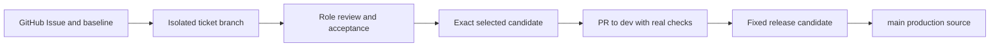

# Repository technical overview

**Purpose:** Explain what the planned CivicWindow source repository contains, who owns each area, and how independently completed work would move through GitHub. This is an architecture and workflow description, not an application build guide.

**Status and authority:** This document reflects the current staging tree and the proposed physical mapping in `CivicWindow_Blueprint_v0.7.md` (November 5, 2026), while preserving the branch and integration design in v0.6. Both blueprint files live in the separate COS359 planning workspace; v0.7 calls itself a candidate. This repository's root is the source root. Until the team publishes it, there is no `.git`, remote, Issues, pull requests, branch protections, CI or working build. The project is selected and the three leads are assigned.

## What this repository is for

The intended repository is one versioned source and decision history for CivicWindow, a proposed native Android civic-information application. It will hold the complete shared rules and interfaces, the Android host and feature source, AI/ML runtime and development assets, data connectors and storage, cross-role tests, and approved build/release controls. A completed feature should be independently reviewable and selectable without forcing unrelated blocked work into integration. A distributed app must correspond to a fixed, reviewed source and dependency set.

The current `CivicWindow/` directory is the single staging source root. When a new parent project folder is chosen, the whole directory moves beneath it. Optional local clones or linked worktrees belong outside that canonical source root. They are working copies of the same future repository, not separate role repositories. `dist/` is generated local output. See the [source tree and current status](SOURCE_TREE_AND_STATUS.md) and [physical workspace mapping](WORKSPACE_BLUEPRINT.md).

## Who owns the work

| Planned role | Primary source area | Responsibility at the boundary |
|---|---|---|
| AI/ML lead | `modules/ai/`, `ml/` | Classifier, matching and inference behavior; model provenance, evaluation and accepted model inputs |
| Android/Product lead | `app/`, `modules/android/` | Application host, user flows, on-device presentation, accessibility and device behavior |
| Data Integration/Platform lead | `modules/data/`, `connectors/` | Retrieval, normalization, jurisdiction/source coverage, local data behavior and evidence provenance |

The pitch uses a three-to-five-person staffing model. The repository design has three permanent role lanes for the three-person case; added contributors would work within those lanes unless the architecture is deliberately revised. All three roles receive complete `governance/`, `schemas/`, `contracts/` and `docs/` in their planned working views. They also need their declared root build files, role configuration, fixtures, scripts, tools and accepted cross-role dependencies. Sparse checkout limits visible paths; it does not make a module buildable or restrict permission. The role build files (project lists) are written and no build has run yet (the first CI run after publication checks them); the exact sparse checkout paths and clean-checkout proof are still pending. See [role onboarding](../operations/ROLE_ONBOARDING.md) and [build profiles](../operations/BUILD_PROFILES.md).

Shared interface changes require affected producer and consumer review. Integration, release and backup duties are assigned among the three leads; this design does not add a fourth engineering role. The project owner retains decisions on staffing, repository publication and unresolved architecture choices. See [ownership and coverage](../operations/OWNERSHIP_AND_COVERAGE.md).

## Planned branches and GitHub route

The proposed GitHub-hosted canonical repository has one Git history. Its five permanent branches have distinct purposes:

| Branch | Planned role |
|---|---|
| `main` | Protected source for approved production releases |
| `dev` | Central integration and validation |
| `role/ai-ml` | Accepted AI/ML work |
| `role/android` | Accepted Android/Product work |
| `role/data-platform` | Accepted Data/Platform work |

All assigned leads are intended to have read access to `main` and the shared foundation. Their write permissions, required reviewers and branch protections must be configured at publication. A lead can check out the relevant role branch in their own clone, or use a linked worktree. That checkout is still a view of the one repository. Ticket branches are short-lived and record their baseline and prerequisites. Pushing a ticket or role branch to GitHub does not itself move code into `dev` or `main`. Repository visibility, host account, permissions, required reviews and protection rules have not yet been configured. See [branching policy](../../governance/BRANCHING_POLICY.md) and [worktree guidance](../operations/WORKTREE_GUIDE.md).

The proposed asynchronous path is:

1. **Issue and baseline.** A GitHub Issue would identify the feature, lead, acceptance examples, affected contracts, integration baseline, prerequisites and blocker state. Architecture decisions go in ADRs; the issue remains the live work record.
2. **Isolated ticket work.** A lead works on a ticket branch from a recorded baseline and runs the module and affected contract checks. A dependency on unfinished work is explicit. The lead requests review of the exact ticket changes before accepting them into the role lane.
3. **Role acceptance.** Reviewed ticket work may enter the role branch. Several accepted tickets can coexist there. That branch is a lead's acceptance lane, not the integration candidate for every ticket on it.
4. **Selected candidate.** To integrate a completed feature, select its exact ticket changes and complete prerequisite set. Record source revision or equivalent mapping, contract versions, real dependency/model identities, checks, artifact digest and review. If A and B are on a role branch but B is unrelated and blocked, an A-only candidate must exclude B in its actual source and package bytes. A changed selection needs new evidence.
5. **Integration pull request.** Prepare a PR against the current `dev` containing only the selected work and prerequisites. Review the resulting composition and run checks with the real selected implementations. Conflicts or changed target/source/dependencies require affected checks to be refreshed. The final Git mechanics must preserve traceability even when a cherry-pick or squash changes commit identity.
6. **Fixed release candidate.** Select one exact integrated commit and dependency manifest; validate that fixed composition and output. Later `dev` commits do not change it. Only reviewed, validated production source reaches `main`; hotfixes return to `dev` and affected role baselines.

This route is proposed, not operational. No Issue, PR, workflow run, candidate or release is implied by the diagram. See [ticket workflow](../operations/TICKET_WORKFLOW.md), [candidate promotion](../operations/CANDIDATE_PROMOTION.md), [integration policy](../../governance/INTEGRATION_POLICY.md) and [release process](../operations/RELEASE_PROCESS.md).

## How asynchronous work remains independent

An engineer's normal work must use only declared source, the full shared foundation and approved dependencies. Focused role tests may use explicit substitutes with agreed outputs; they do not prove the real integrated application. Cross-role implementation packages must be versioned and pinned before a dependent role can build against them independently. A blocked ticket records its dependency while unrelated completed work remains selectable. A genuinely shared prerequisite still blocks the feature that needs it.

Shared foundation changes reach affected roles through explicit reviewed baseline updates. The update records versions and compatibility, preserves unfinished local work, and stops on conflicts; it never force-resets another lead branch automatically. A production hotfix must likewise reach `dev` and affected role baselines. See [sync procedure](../operations/SYNC_PROCEDURE.md).

The design requires clean-checkout checks for each role, contract compatibility, candidate source/package correspondence and real integration. Those checks do not exist yet. Folder presence and a sparse checkout alone cannot establish independent buildability. See [module dependencies](MODULE_DEPENDENCIES.md), [test strategy](../testing/TEST_STRATEGY.md) and [candidate promotion](../operations/CANDIDATE_PROMOTION.md).

## Claim and evidence ledger

| Claim in this overview | Basis inspected | Current verification boundary |
|---|---|---|
| One source root now; one future repository, with independent working copies | Current root layout; v0.7 §§1, 3; [workspace mapping](WORKSPACE_BLUEPRINT.md) | The source folders exist directly under CivicWindow; Git and linked checkouts do not yet exist |
| Five permanent branch names and their roles | v0.6 §2.1; v0.7 §3; [branching policy](../../governance/BRANCHING_POLICY.md) | Planned names only; no refs or protection settings exist |
| Three ownership lanes with complete shared foundation | v0.6 §4; v0.7 §§2, 4; [role onboarding](../operations/ROLE_ONBOARDING.md) | Role/feature directories and documents exist; the three leads are assigned; no verified sparse profiles |
| Ticket isolation and selective promotion | v0.6 §9; v0.7 §5; [ticket workflow](../operations/TICKET_WORKFLOW.md) | Policy only; no GitHub issue, PR, candidate or executable check |
| Fixed release source and hotfix return | v0.6 §§9–10; v0.7 §6; [release process](../operations/RELEASE_PROCESS.md) | Policy only; no release artifacts or retained evidence |

**Next decisions, outside this overview item:** Prove the selected toolchain and the first module graph (drafted; no build has run yet, and the first CI run after publication checks them), define shared schemas/contracts and the remaining parts of each role profile, choose and configure the GitHub repository and review controls, assign people and coverage, and prove the workflow with real checks. Application build details and pitch-aligned product behavior are mapped in the [application build plan](APPLICATION_BUILD_PLAN.md).
