# Design Document

## CivicWindow

**Application logo:** a placeholder. The team will add the logo later.

| Team Member | Email |
|---|---|
| Dwight Thompson (AI/ML Lead and Data Integration/Platform Lead) | withheld from the repository copy |
| Steven Asphodel (Android/Product Lead) | withheld from the repository copy |

**Status:** Final draft. This is a dynamic document that the team updates throughout development.

**Contents**

1. Introduction (Purpose, Goal, Existing Solution, Definitions)
2. Overall Description: 2.1 Product Perspective (2.1.1 User interface Hardware; 2.1.2 Hardware interfaces & Memory Constraints; 2.1.3 Software interfaces; 2.1.4 Library Dependencies; 2.1.5 Database; 2.1.6 3rd Party Data and APIs)
3. Specific Requirements: 3.1 Milestones (3.1.1 Minimum Viable Product (A Features); 3.1.2 Alpha (B Features); 3.1.3 Beta (C Feature); 3.1.4 Version 2.0)
4. User Experience: 4.1 Use Cases (4.1.1 to 4.1.17); 4.2 User characteristics; 4.3 User interface (4.3.1 to 4.3.10)
5. Development Environment (Developer Tools; Content Generation Tools; Data Tools; 3rd Party Dependencies and APIs)
- Entity Relational Diagram
6. Production Plans (Code Review Plan; Integration Plan; Testing Plans)
7. Folder Hierarchy
- AI Data Sets

In the repository: the [system architecture](../architecture/SYSTEM_ARCHITECTURE.md), the [feature list](../product/FEATURE_LIST.md) and the [wireframes directory](wireframes/README.md).

## 1. Introduction

### Purpose

CivicWindow is a proposed native Android application that helps residents find municipal and state government activity relevant to their communities. Users choose jurisdictions and interests, the application retrieves public records, and locally running AI classifies and matches those records. Each result includes source information and a link to the official material, so users can inspect the evidence themselves. The planned stack is Kotlin with Jetpack Compose for the interface (a first screen exists), Room on SQLite for local data, WorkManager for background retrieval, and LiteRT or ONNX Runtime Mobile for the on-device models; apart from that first screen, none of it is built yet.

The proposed core experience requires no mandatory account, no recurring subscription and no hosted AI inference service. Internet access is required for new records and for the initial model download. Downloaded records, interest profiles and core inference remain on the device. Public-source access, mobile performance and model accuracy still have to be validated during development.

This document describes the software's architecture and data design. It is a final draft: features are proposed, and no feature is claimed as implemented. The readers are the three leads, who share the integration, testing, review and release duties for the project.

### Goal: What problem is this solving?

Decisions that affect housing, zoning, transportation, utilities, taxes, schools, public space, development and local services often first appear in agendas, meeting packets, notices or proposed legislation. These records are public, but access to them is fragmented:

- each jurisdiction may use a different publishing vendor or website;
- agenda packets may be long PDFs with weak searchability;
- residents must know which council, board, commission or committee matters;
- available subscription tools often alert users that a document was posted rather than identify the items relevant to them;
- state and municipal information are usually separated;
- centralized services may require accounts and store interests, location and reading behavior.

In a January 2024 Pew Research Center survey of 5,146 U.S. adults, 45% said it is very or somewhat easy to find the information needed for local voting decisions. This establishes interest and an information-access challenge; it does not measure demand for CivicWindow or prove product-market fit.

CivicWindow is meant to answer one bounded question: “What has my local or state government officially published that matches my location and interests, what does the source actually say, and when can I respond or attend?” It is a discovery and evidence-navigation tool. It must not silently replace the official record, predict political intent, recommend a political position, or present generated prose without direct supporting evidence. A source check shows where displayed information came from and whether quoted text matches the retrieved record; it does not establish that the official record is correct, that a proposal was adopted, or that the application found every relevant item.

### Existing Solution

No earlier CivicWindow project is described in the project documents. This draft is based on the team's master pitch (version 1.3, October 29, 2026), the capstone feasibility report and the repository blueprint (version 0.7). **Repository and overview videos:** the repository link is added when the repository is published, and there is no overview video yet.

Comparable products already exist. Civic Brief is one, and MuniWatch (https://muniwatch.app/) offers summaries and topic alerts; CivicClerk and CivicPlus provide public meeting portals; the Council Data Project (https://councildataproject.org/cdp-backend/) and Agenda Watch show strong open civic-data and journalism uses. The pitch states: “Personalized civic alerts already exist. CivicWindow's proposed distinction is the combination of on-device inference, locally maintained interests, source traceability, and portable exports without a core subscription dependency.”

### Definitions

| Term | Meaning in this document |
|---|---|
| Jurisdiction | A supported municipal or state government whose public records the application can retrieve. Only validated sources count as supported. |
| Civic record | One retrieved item in the application's common record form, such as an agenda item or legislative matter, with its source link, retrieval time and content hash. |
| Connector | A versioned component that retrieves records from a government source and converts them to the common civic-record form. |
| Interest profile | The plain-language topics, organizations, named projects, addresses or geographic radii a user chooses. It stays on the device. |
| On-device (local) inference | Running the AI models on the Android device, with no hosted AI service. |
| Topic classification | A fine-tuned model assigns topic labels, with a numeric confidence, to a record from its text and metadata. |
| Semantic matching | An embedding model turns records and interest text into numeric vectors; the similarity score ranks records for a user's interests. |
| Weak label | A topic label taken from a source's own category. It stays provisional until reviewers confirm or correct it. |
| Evidence Pack | A user-directed JSON or Markdown export of selected record metadata, jurisdiction, source links, retrieval information, relevant excerpts and clearly identified model outputs or uncertainty. |
| Category A, B, C | The feature groups: A is the core minimum viable product, B is growth, C is enhancement. |
| WorkManager | The Android component the application uses to schedule best-effort background retrieval. |
| Room / SQLite | The local database technology proposed for records and interests. |
| OCR | Recovering text from scanned pages. Advanced OCR is a Category B feature. |
| Role branch | One of the permanent Git branches that hold accepted work by a lead: `role/ai-ml`, `role/android`, `role/data-platform`. |
| Ticket branch | A short-lived branch for one ticket, named `feature/<n>-<short-name>` or `fix/<n>-<short-name>`. |

## 2. Overall Description

### 2.1. Product Perspective

CivicWindow is a proposed native Android application. A resident would choose supported municipal or state jurisdictions and keep an interest profile on the device. Validated connectors would retrieve public records when the network is available. The application would normalize and store those records locally, classify their civic topics and match them to the resident's interests with on-device models. The user would see matched records with source status, dates, excerpts and official links, and could request an Evidence Pack. Optional notifications would follow a successful retrieval and match when Android and the user permit them. The application would show the last successful refresh and offer a manual refresh.

Figure 1 shows the proposed data path. It is a proposal, not a claim that every action runs at the same time. Classification and matching keep their model identity and uncertainty. Source identity, original links, retrieval state and timestamps travel with the normalized record. A failed fetch, an empty successful result, stale local data, a missing model and an uncertain match need distinct presentation states.

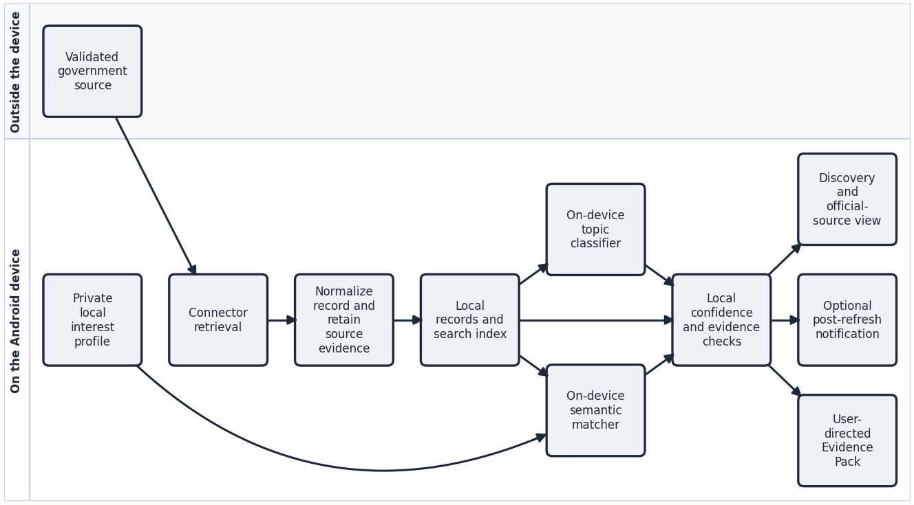

**Figure 1.** The proposed data path, from a government source to discovery, notification and export.

#### 2.1.1. User interface Hardware

The application is native Android (Kotlin and Jetpack Compose). The interface would use these Android features; none of them is built yet:

- Android location APIs, only with explicit permission; manual jurisdiction selection would remain available if the user denies location permission;
- Android notifications for locally matched items;
- the Storage Access Framework for explicit exports.

The user would operate the interface by touch on an Android phone: the project documents describe no voice, gesture, keyboard or tablet interaction. The supported devices are phones running Android 8.0 (API level 26) or higher (see 2.1.3). The screen sizes, orientations and accessibility states are decisions still to be made with the screen designs (see 4.3).

#### 2.1.2. Hardware interfaces & Memory Constraints

The only hardware named is an Android device that runs the application and its models. At least one designated tester must have access to a physical Android device. Weekly build demonstrations will use tested device behavior, and emulator-only results will not establish device readiness. Device access is a prerequisite to establish during kickoff, not an already confirmed resource.

Preliminary compressed distribution budget:

| Component | Preliminary compressed budget |
|---|---|
| Android application and ingestion libraries | 70–180 MB |
| OCR and PDF components | 80–250 MB |
| Classifier, extractor, and embedding models | 120–500 MB |
| Jurisdiction registry and initial schemas | 10–100 MB |
| Reserved headroom | 200–500 MB |
| **Recommended target** | **480 MB–1.53 GB** |

The initial download need not contain years of government documents; content is fetched directly and stored locally after jurisdiction selection. The application should stay substantially below the 3.6 GB cap, because large initial downloads would undermine adoption.

Model loading and task scheduling will respect device memory and power limits, without requiring every model to run at the same time. Sub-billion parameter counts alone do not establish acceptable memory use, latency, battery consumption or joint deployment feasibility. The project documents state no measured figures for run-time memory, the minimum device or local storage. The following is a target to be tested, not a measurement:

- **Run-time memory:** the application would stay within about 1 GB of memory while one model is loaded, and would load models one at a time (the decision record on the inference runtime).
- **Minimum device and local storage:** the project documents state no figure for either. The minimum Android version is in 2.1.3, and the distribution budget above bounds the installed size. The team will set the device and storage targets from measurements on a physical device, which is also how the inference runtime is chosen.

#### 2.1.3. Software interfaces

- **Operating system:** Android. The minimum would be Android 8.0 (API level 26) and the target Android 16 (API level 36), the level Google Play requires of new applications from 31 August 2026 (the decision record on the SDK levels). Testing would cover the minimum, a middle release and the target, and at least one physical device.
- **Background retrieval:** WorkManager will schedule best-effort background retrieval. Periodic jobs have a minimum configurable interval of 15 minutes (Android developer documentation on WorkManager), which is not a delivery guarantee. CivicWindow promises neither instant monitoring nor exact-time or 15-minute alerts.
- **Notifications:** after a successful fetch, the app will classify new records, match interests, and post eligible local notifications when the user has enabled them and Android permits delivery. Network availability, power management, work constraints and source failures can delay this. Records remain visible in the application if notifications are disabled.
- **Location:** Android location APIs, with explicit permission only.
- **Exports:** the Storage Access Framework, for explicit user-directed exports.
- **Government data sources:** over the network, through connectors (see 2.1.6).

#### 2.1.4. Library Dependencies

| Layer | Proposed technology or approach |
|---|---|
| Application and interface | Kotlin and Jetpack Compose |
| Local persistence | Room / SQLite and local full-text indexing |
| Background retrieval | Android WorkManager with network constraints and retry handling |
| Integration | Versioned connectors and a common civic-record schema |
| AI inference | LiteRT or ONNX Runtime Mobile, selected through compatibility and performance testing |
| Search and matching | Full-text search plus local embeddings |
| Development quality | Git, code review, continuous integration, automated tests and reproducible evaluation |

These are proposals. No runtime, model, version or external source is approved merely by appearing in this table. The library versions are the recent stable releases listed in section 5: Kotlin 2.4.21, Compose 1.12 with Material 3 1.4.0, WorkManager 2.12.0 and Room 2.8.5, built with Gradle 9.6.0, Android Gradle Plugin 9.3.3 and JDK 17. The decision records on the application stack and the build toolchain accept these baselines, and the repository's version catalog and wrapper settings hold the build versions; all are checked again at the first CI run after publication. Four things do not rest on an accepted record: the Python lock tool (uv), the test libraries and coverage tools, Git and PowerShell. The first two rest on decision records that are still Proposed, and the other two on the development guide's proposed baseline. The runtime (LiteRT or ONNX Runtime Mobile) would be one of the two, chosen by a test run on a physical device. The model packages would be the three candidates in section 5, each converted to the chosen runtime's format and fixed by its content hash.

#### 2.1.5. Database

The database would be local to the device: Room / SQLite with full-text search and a compact local vector index. It is not cloud-based. The application needs no CivicWindow server and no user account, and a full local-data deletion control is required. The proposed tables are in the Entity Relational Diagram section, which also says where the two indexes are stored and how a table maps to a Room entity. The project documents list the schema fields, migrations, retention and offline query behavior as pending. Offline, search and ranking would use only the records already downloaded, and offline views identify the last successful refresh and do not imply current monitoring.

#### 2.1.6. 3rd Party Data and APIs

- **Legistar Web API:** the design would read municipal legislative records from the jurisdictions that publish through Legistar.
- **Open States / Plural Open:** state legislative information through an API and bulk downloads (https://docs.openstates.org/; bulk data at https://open.pluralpolicy.com/data/). The API requires keys (https://docs.openstates.org/api-v3/). The design must handle the keys and plan when records are refreshed.
- **Council Data Project:** an open-source project (https://councildataproject.org/cdp-backend/) with searchable municipal meeting data (https://councildataproject.org/seattle/).
- **Official municipal agenda portals and document archives:** PDF, HTML, RSS or vendor-specific records.

A source counts as supported only after validation of its access terms, authentication requirements, rate limits, supported formats and repeatable retrieval. Public visibility alone does not establish reusable API access. Government-data APIs supply records; they are not AI inference APIs. The pitch's research pool is Madison, Seattle, Austin, Raleigh, Atlanta, Charlotte, Miami, Houston, New York City and Washington, DC. These are integration candidates, not confirmed supported jurisdictions. The release objective is four to six municipalities plus one state legislative source, as the pitch's objective states, conditional on connector validation. The supported set is not yet fixed: it is to be fixed during feasibility planning, from the research pool, and it should cover at least two publishing patterns, such as Legistar plus a PDF, RSS or HTML source. The state source is the Open States API or its bulk data. Access terms would be checked for each source: the Legistar Web API serves participating clients, Open States requires an API key and its update schedules must be built into the design, and the terms of each agenda portal would be read before its connector is built.

## 3. Specific Requirements

### 3.1. Milestones

The requirements are 23 user stories in the form “The User will be able to do X”, grouped by milestone: 14 for the Minimum Viable Product (A1 to A14), 5 for Alpha (B1 to B5) and 4 for Beta (C1 to C4). They come from the nineteen features in the project's master pitch: ten core (Category A), five growth (Category B) and four enhancement (Category C) features. Each story carries a “Done when” line and a “Source” line. The source line names the feature in the master pitch, or the row of the application build plan, that states the outcome. Where a core feature states more than one separately testable outcome, it is written as more than one story: A10 is the refresh half of feature 9, A12 is the deletion path of feature 1, A13 is the retrieval status of feature 3, and A14 is the evidence problem of feature 8. The “Done when” lines of the A stories are the proposed proofs from the application build plan, not approved thresholds: exact thresholds, fixtures and supported devices still need approval, and no feature is implemented yet.

#### 3.1.1. Minimum Viable Product (A Features)

The essential functionality: the minimum needed to show a working proof of concept across the three role lanes. Category A is due by the end of Month 2 of Software Architecture; this will be done in Month 2 (Software Architecture) of Capstone. The project plans in project months, not calendar dates, and the master pitch maps the actual course dates when the team schedule is established. The acceptance cases are the “Done when” lines below. The build plan validates the Month 2 core on devices: it demonstrates the Category A outcomes, including model loading, inference, offline search, retrieval recovery, evidence inspection, notification permission handling and export.

- **A1.** The User will be able to start using CivicWindow without creating an account.
  *Done when:* a new user reaches discovery without an account.
  *Source:* master pitch, Slide 8, feature 1; application build plan, Category A build map, row 1.
- **A2.** The User will be able to select the supported jurisdictions whose records they want to follow.
  *Done when:* the interface shows only validated supported jurisdictions and keeps the user's selection locally; unsupported coverage is not advertised.
  *Source:* master pitch, Slide 8, feature 2; application build plan, row 2.
- **A3.** The User will be able to rely on records from the supported jurisdictions being ingested through validated connectors.
  *Done when:* at least two approved jurisdiction sources yield repeatable records with source identifiers and links; the exact source set is decided through access validation.
  *Source:* master pitch, Slide 8, feature 3; application build plan, row 3.
- **A4.** The User will be able to search and open previously downloaded records without a network connection.
  *Done when:* downloaded records can be searched and opened offline, and the interface distinguishes the last successful refresh from current data.
  *Source:* master pitch, Slide 8, feature 4; application build plan, row 4.
- **A5.** The User will be able to create and change interests that are stored only on their device.
  *Done when:* a user can create and change locally held interests, and the matching boundary consumes the agreed profile contract; storage and deletion behavior are reviewed.
  *Source:* master pitch, Slide 8, feature 5; application build plan, row 5.
- **A6.** The User will be able to see civic topic labels with a confidence score from the on-device classifier; low-confidence results are labeled uncertain or withheld from automated topic claims.
  *Done when:* a fine-tuned classifier emits documented topic labels, numeric confidence and model provenance against reviewed held-out examples, and physical-device loading and inference are measured.
  *Source:* master pitch, Slide 8, feature 6, and Slide 7; application build plan, row 6.
- **A7.** The User will be able to see downloaded records ranked by how well they match their interests, with the ranking computed on the device.
  *Done when:* downloaded records and private interests can be ranked locally, and relevance evaluation and physical-device cost are reported against agreed baselines.
  *Source:* master pitch, Slide 8, feature 7; application build plan, row 7.
- **A8.** The User will be able to inspect each result's source excerpts, relevant dates and official link, with source text kept separate from model inference and uncertainty shown.
  *Done when:* a result separates source text from model inference and exposes official links, relevant dates, excerpts and uncertainty.
  *Source:* master pitch, Slide 8, feature 8; application build plan, row 8.
- **A9.** The User will be able to receive an optional notification after a successful retrieval and match, when they have enabled notifications and Android permits them.
  *Done when:* notifications occur only after successful retrieval and matching when enabled and permitted, and denied permission, delayed background work and a failed refresh are exercised.
  *Source:* master pitch, Slide 8, feature 9; application build plan, row 9.
- **A10.** The User will be able to see when the last successful refresh happened and to start a refresh manually.
  *Done when:* the manual refresh is exercised alongside A9's cases, and the interface distinguishes the last successful refresh from current data.
  *Source:* master pitch, Slide 8, feature 9 (refresh status and manual refresh); application build plan, rows 4 and 9.
- **A11.** The User will be able to export selected records as an Evidence Pack in JSON or Markdown.
  *Done when:* a user-directed export contains selected record metadata, jurisdiction, source links, retrieval information, excerpts, and labeled model outputs or uncertainty.
  *Source:* master pitch, Slide 8, feature 10, and its Evidence Pack paragraph; application build plan, row 10.
- **A12.** The User will be able to delete all the data CivicWindow keeps on the device.
  *Done when:* a full local-data deletion control is available, and any local data created by onboarding has a defined deletion path.
  *Source:* feasibility report, section 11 (a full local-data deletion control is required); decision record ADR-0001; application build plan, row 1.
- **A13.** The User will be able to see the retrieval status of each source, so that a failed or empty retrieval is not mistaken for a successful one.
  *Done when:* each source shows the outcome of its last retrieval, and a failed fetch, an empty successful result and stale local data look different from one another.
  *Source:* application build plan, row 3 (retrieval status and failure cases); data flow note; feasibility report, section 6 (visible source freshness and last-successful-fetch status).
- **A14.** The User will be able to see when an excerpt or an official link does not match the retrieved record.
  *Done when:* broken or mismatched evidence is handled visibly, and the result is accepted, rejected or marked uncertain.
  *Source:* application build plan, row 8; master pitch, Slide 7 (evidence validation).

A passing substitute test proves only the isolated case it exercised. Core completion also needs real producer and consumer contracts, integrated application behavior and relevant physical-device checks.

**Geographic scope.** The initial release objective is four to six municipalities plus one state legislative source, conditional on connector validation and team capacity (master pitch, Slide 8). Category A still requires a working multi-jurisdiction implementation. The pitch's ten-city list is a research pool, not confirmed support. The supported set is not yet fixed: it is to be fixed during feasibility planning (application build plan). The candidates come from the ten-city pool, and the set should cover at least two publishing patterns, such as Legistar plus a PDF, RSS or HTML source (feasibility report, section 6). The state source is the Open States API or bulk data. A jurisdiction joins the supported set only after its connector passes validation.

#### 3.1.2. Alpha (B Features)

The growth functionality. The template places Alpha in Month 3 (Project and Portfolio VI) of Capstone. Category B work is planned for that month: the master pitch plans Month 3 to harden the integrated MVP and to add selected Category B work if capacity permits. Category B stays outside the Category A completion claim unless a later approved plan selects it (application build plan).

- **B1.** The User will be able to follow additional jurisdictions that new connectors make available.
  *Done when:* a new connector adds a jurisdiction only after the same validation as the first connectors, and the user selects it as they select any other jurisdiction.
  *Source:* master pitch, Slide 8, feature 11; feasibility report, sections 6 and 14.
- **B2.** The User will be able to see the entities, actions and deadlines extracted from a record, each with the supporting excerpt from the source.
  *Done when:* each extracted entity, action or deadline is shown with its supporting excerpt, information the record does not state gets no invented value, and extraction is evaluated by evidence-span correctness.
  *Source:* master pitch, Slide 8, feature 12, and Slide 7 (extraction under Category B); feasibility report, section 7.
- **B3.** The User will be able to see when an official document has changed, with its version history and the differences between versions.
  *Done when:* a changed official document is stored as a new version beside the earlier one, and the differences between the versions are shown.
  *Source:* master pitch, Slide 8, feature 13; feasibility report, section 5 (track changes) and section 7 (change detector).
- **B4.** The User will be able to use records from advanced PDF agendas, including scanned pages processed by OCR.
  *Done when:* text recovered from scanned pages appears with the record, and the record keeps its link to the original document.
  *Source:* master pitch, Slide 8, feature 14 (advanced OCR remains Category B); feasibility report, sections 6 and 7.
- **B5.** The User will be able to filter results by geography and by entity.
  *Done when:* filtering by geography and by entity narrows the downloaded records on the device.
  *Source:* master pitch, Slide 8, feature 15; feasibility report, section 5 (geographic radii) and section 6 (entity and proximity interests).

#### 3.1.3. Beta (C Feature)

The enhancement functionality. The template places Beta in Month 4 (Software Integration) of Capstone. Category C is an optional enhancement that the master pitch adds only if its measured benefit justifies its device cost; Month 4 is formal testing, and the pitch does not schedule Category C. C features stay outside the Category A completion claim unless a later approved plan selects them (application build plan).

- **C1.** The User will be able to use an optional compact on-device reasoning model, if its measured benefit justifies its device cost.
  *Done when:* the optional model is included only if its measured benefit justifies its device cost, and it loads within the device's memory and power limits.
  *Source:* master pitch, Slide 8, feature 16, and Slide 7 (optional reasoning).
- **C2.** The User will be able to classify and discover records in more than one language.
  *Done when:* classification and discovery work for records in an added language, with low-confidence results labeled uncertain as in the first language.
  *Source:* master pitch, Slide 8, feature 17; feasibility report, section 14 (multilingual support).
- **C3.** The User will be able to benefit from a connector framework through which the community contributes connectors.
  *Done when:* a contributed connector comes with fixtures, expected records, update cadence, license notes and automated health tests, and joins the registry only after validation.
  *Source:* master pitch, Slide 8, feature 18; feasibility report, section 14.
- **C4.** The User will be able to see enhanced evidence reports and comparisons.
  *Done when:* a report or comparison contains only labeled source text, source links and labeled model output, and labels them as the Evidence Pack does.
  *Source:* master pitch, Slide 8, feature 19, and its Evidence Pack paragraph.

#### 3.1.4. Version 2.0

No post-course features are named in the project documents, so this section is left blank for the team, as the template allows.

## 4. User Experience

### 4.1. Use Cases

This section describes how the user travels through CivicWindow. There are seventeen use cases, each with its preconditions, main flow, sub-flows and a flow diagram: use cases 1 to 8 cover the Minimum Viable Product (A stories), use cases 9 to 13 cover Alpha (B stories) and use cases 14 to 17 cover Beta (C stories). They follow the product workflow in the project's master pitch: select supported jurisdictions and create a local interest profile; retrieve public records through validated connectors; normalize, classify and rank them on the device; inspect matched results, source excerpts and official links; receive optional notifications; export selected material in an Evidence Pack. The Alpha and Beta use cases follow the growth and enhancement features of the same pitch.

The flows of use cases 1 to 7 follow the nine-step MVP experience in the project's feasibility report and the workflow above; those of use cases 8 to 17 follow the pitch's feature list and the feasibility report's account of the growth and enhancement features. Each flow shows one possible path for planned behavior. The flows use the screens in section 4.3, and three of them add controls that the nine layouts do not draw yet: the version history (use case 11), the filter (use case 13) and the settings through which the optional model is chosen (use case 14). All of these flows describe planned behavior: no use case is implemented yet.

Every one of the 23 user stories in section 3.1 maps to a use case, and every use case has a flow figure. Stories share a use case only where the flow is the same.

| Story | Use case | Flow figure |
|---|---|---|
| A1, A2 | 4.1.1 Use case 1: Start privately and choose jurisdictions | Figure 2 |
| A3, A13 | 4.1.2 Use case 2: Refresh records from official sources | Figure 3 |
| A5 | 4.1.3 Use case 3: Set and change interests | Figure 4 |
| A6, A7, A8, A14 | 4.1.4 Use case 4: Discover matched records and inspect the evidence | Figure 5 |
| A9, A10 | 4.1.5 Use case 5: Receive a notification and refresh manually | Figure 6 |
| A11 | 4.1.6 Use case 6: Export an Evidence Pack | Figure 7 |
| A4 | 4.1.7 Use case 7: Search downloaded records offline | Figure 8 |
| A12 | 4.1.8 Use case 8: Delete all local data | Figure 9 |
| B1 | 4.1.9 Use case 9: Follow an additional jurisdiction | Figure 10 |
| B2 | 4.1.10 Use case 10: See extracted entities, actions and deadlines | Figure 11 |
| B3 | 4.1.11 Use case 11: See document changes and version history | Figure 12 |
| B4 | 4.1.12 Use case 12: Read a scanned agenda | Figure 13 |
| B5 | 4.1.13 Use case 13: Filter results by geography and entity | Figure 14 |
| C1 | 4.1.14 Use case 14: Use the optional reasoning model | Figure 15 |
| C2 | 4.1.15 Use case 15: Discover records in another language | Figure 16 |
| C3 | 4.1.16 Use case 16: Add a connector through the community framework | Figure 17 |
| C4 | 4.1.17 Use case 17: View an enhanced evidence report or comparison | Figure 18 |

Failure states stay distinct in every flow: an unavailable source, malformed input, stale data, an unavailable model, an empty successful result and an uncertain match are different states and are shown differently.

#### 4.1.1. Use case 1: Start privately and choose jurisdictions

**Stories covered:** A1 and A2.

**Preconditions:** CivicWindow is installed. No account exists, and none is needed.

**Main Flow:** (i) The user opens CivicWindow for the first time and reaches the first screen without creating an account. (ii) The user chooses coverage privately: by entering a ZIP code or address, or by granting one-time location access. (iii) The application matches the location to supported jurisdictions on the device. (iv) The application lists only validated supported jurisdictions, and the user selects the ones to follow. (v) The application keeps the selection on the device and continues to interest selection (use case 3).

**SubFlows:**
- I. The user denies location permission: manual jurisdiction selection remains available.
- II. The location matches no supported jurisdiction: the application says so and does not advertise unsupported coverage.
- III. The user later removes local data: a full local-data deletion control is available (use case 8), and any local data created by onboarding has a defined deletion path.

Figure 2 shows the first-run path with no account and the alternative when location permission is denied.

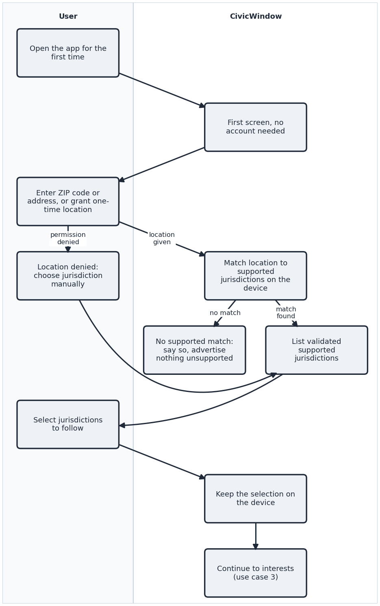

**Figure 2.** Flow of use case 1: start privately and choose jurisdictions.

#### 4.1.2. Use case 2: Refresh records from official sources

**Stories covered:** A3 and A13.

**Preconditions:** At least one jurisdiction is selected, and a validated connector exists for it.

**Main Flow:** (i) A refresh starts, either as scheduled background work or when the user requests a manual refresh. (ii) The connector contacts the official source directly when the network is available. (iii) The application normalizes the content and metadata without losing the original official link or source identifiers. (iv) The application stores the records on the device and records the retrieval time and outcome. (v) The application classifies and matches the new records on the device (use case 4) and updates the last successful refresh. (vi) The application shows the outcome of the last retrieval of each source.

**SubFlows:**
- I. The source is unavailable or returns malformed input: the application keeps the earlier records, shows the failure, and does not mark the refresh successful.
- II. The retrieval succeeds with no new records: the application shows an empty successful result, which is not a failure.
- III. The network is unavailable: the application works from downloaded records and shows the last successful refresh.
- IV. Android delays the background work: the refresh happens later; CivicWindow promises no instant or exact-time monitoring.

Figure 3 shows retrieval, local storage and the distinct outcomes: success, an empty successful result and failure.

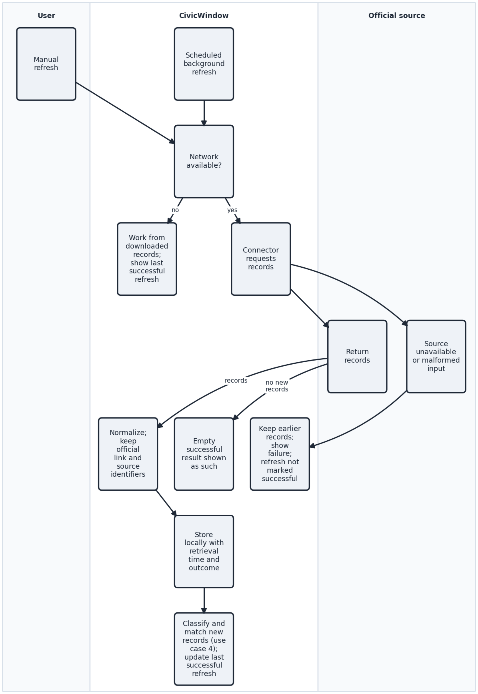

**Figure 3.** Flow of use case 2: refresh records from official sources.

#### 4.1.3. Use case 3: Set and change interests

**Stories covered:** A5.

**Preconditions:** The user has completed first-run setup. The interest profile is stored only on the device.

**Main Flow:** (i) The user opens the interests screen. (ii) The user adds plain-language topics, organizations, named projects, addresses or geographic radii. (iii) The application stores the interests locally. (iv) The matching component uses the stored interests the next time it ranks records.

**SubFlows:**
- I. The user changes or removes an interest: the stored profile changes, and later ranking uses the new profile.
- II. The user deletes all local data (use case 8): the interest profile is deleted with it.

Figure 4 shows that interests are created, changed and deleted only on the device, and that they feed the next ranking.

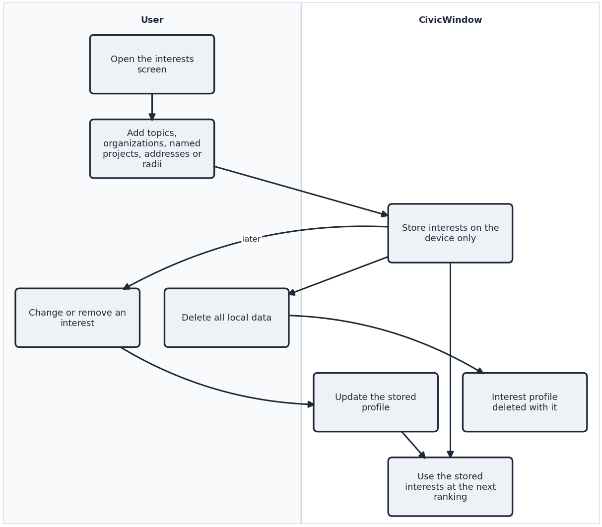

**Figure 4.** Flow of use case 3: set and change interests.

#### 4.1.4. Use case 4: Discover matched records and inspect the evidence

**Stories covered:** A6, A7, A8 and A14.

**Preconditions:** Downloaded records and at least one interest exist. The classifier and the semantic matcher are expected to be on the device; SubFlow III covers a model that is missing.

**Main Flow:** (i) The application classifies each record and assigns topic labels with numeric confidence. (ii) The application ranks records against the interests with the semantic matcher. (iii) Local control logic combines the two outputs, applies confidence rules and checks that excerpts and links correspond to the retrieved source. (iv) The user opens the discovery view and sees matched records with source status, dates, excerpts and official links. (v) The user opens a record, reads the source text, sees the model's inference marked as such with its uncertainty, and follows the official link to the authority.

**SubFlows:**
- I. Confidence is low: the result is labeled uncertain or withheld from automated topic claims, and the source record stays inspectable.
- II. The excerpt does not match the retrieved record, or the link is broken: the application handles the evidence problem visibly.
- III. A model is missing or cannot load: the application shows that state instead of an empty list.

Figure 5 shows the local classify, match and check steps and how uncertainty and evidence problems are presented.

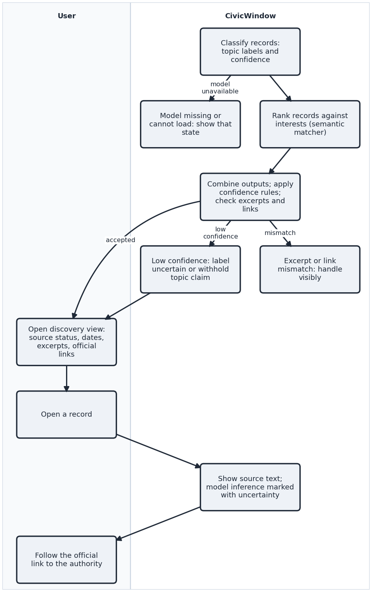

**Figure 5.** Flow of use case 4: discover matched records and inspect the evidence.

#### 4.1.5. Use case 5: Receive a notification and refresh manually

**Stories covered:** A9 and A10.

**Preconditions:** Notifications are enabled in CivicWindow and permitted by Android.

**Main Flow:** (i) A scheduled refresh succeeds and the new records are classified and matched. (ii) If a new record matches an interest, the application posts a local notification. (iii) The user opens the notification and lands on the matched record. (iv) The user can see the last successful refresh and start a manual refresh, which goes into retrieval (use case 2).

**SubFlows:**
- I. The user has disabled notifications: records still appear in the application.
- II. Android denies the notification permission: no notification is posted, and the application keeps working.
- III. The refresh fails: no notification is posted, and the failure is shown.
- IV. Work constraints, power management or source failures can delay the refresh and so the notification; no exact-time promise is made.

Figure 6 shows that a notification follows only a successful retrieval and match, the cases where none is posted, and that a manual refresh goes into retrieval.

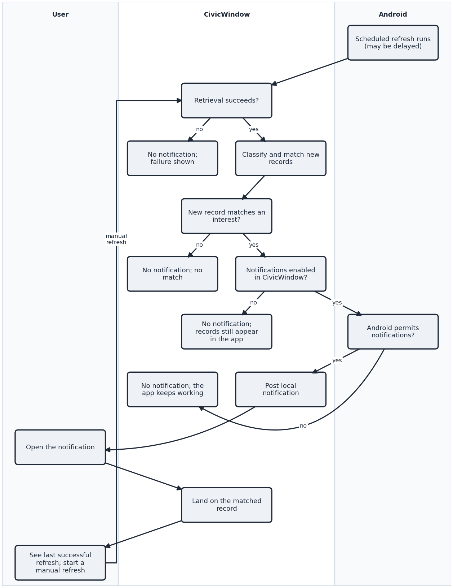

**Figure 6.** Flow of use case 5: receive a notification and refresh manually.

#### 4.1.6. Use case 6: Export an Evidence Pack

**Stories covered:** A11.

**Preconditions:** At least one record is available. Export is directed by the user.

**Main Flow:** (i) The user selects the records to export. (ii) The user chooses JSON or Markdown. (iii) The application builds the pack: selected record metadata, jurisdiction, source links, retrieval information, relevant excerpts, and clearly identified model outputs or uncertainty. (iv) The user chooses where to save the file, and the application writes it there. (v) The user can analyze the pack with any outside tool; that analysis is user-directed and does not require third-party AI authentication or integration within CivicWindow.

**SubFlows:**
- I. The user cancels the file chooser: nothing is written.
- II. A selected record has uncertain model output: the pack labels it as uncertain.

Figure 7 shows that the export is directed by the user and that model output and uncertainty are labeled.

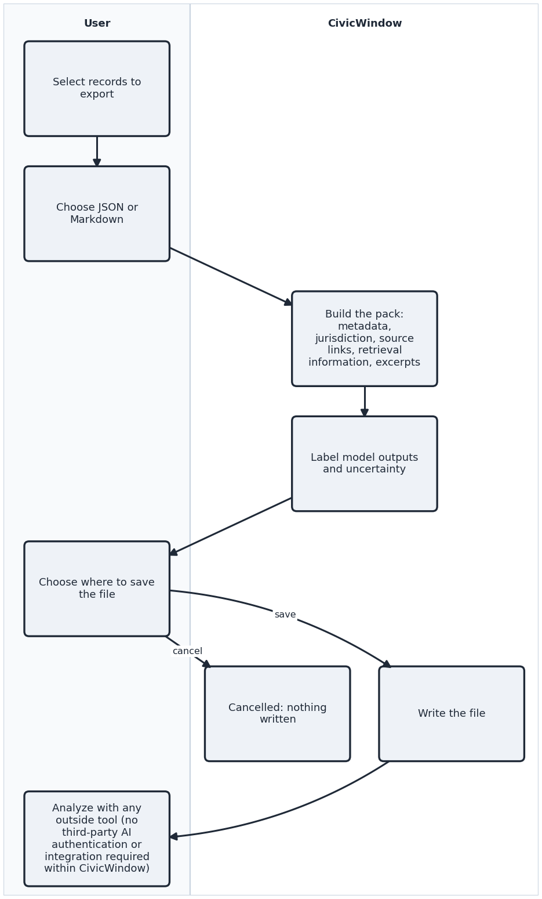

**Figure 7.** Flow of use case 6: export an Evidence Pack.

#### 4.1.7. Use case 7: Search downloaded records offline

**Stories covered:** A4.

**Preconditions:** Records were downloaded earlier. The device has no network connection.

**Main Flow:** (i) The user opens the search. (ii) The user enters a search phrase. (iii) The application searches the downloaded records on the device with full-text and semantic retrieval. (iv) The application shows the results together with the last successful refresh. (v) The user opens a record and reads it.

**SubFlows:**
- I. No downloaded record matches: the application shows an empty result.
- II. The data is old: the view identifies the last successful refresh and does not imply current monitoring.

Figure 8 shows offline search of downloaded records and that old data is not presented as current monitoring.

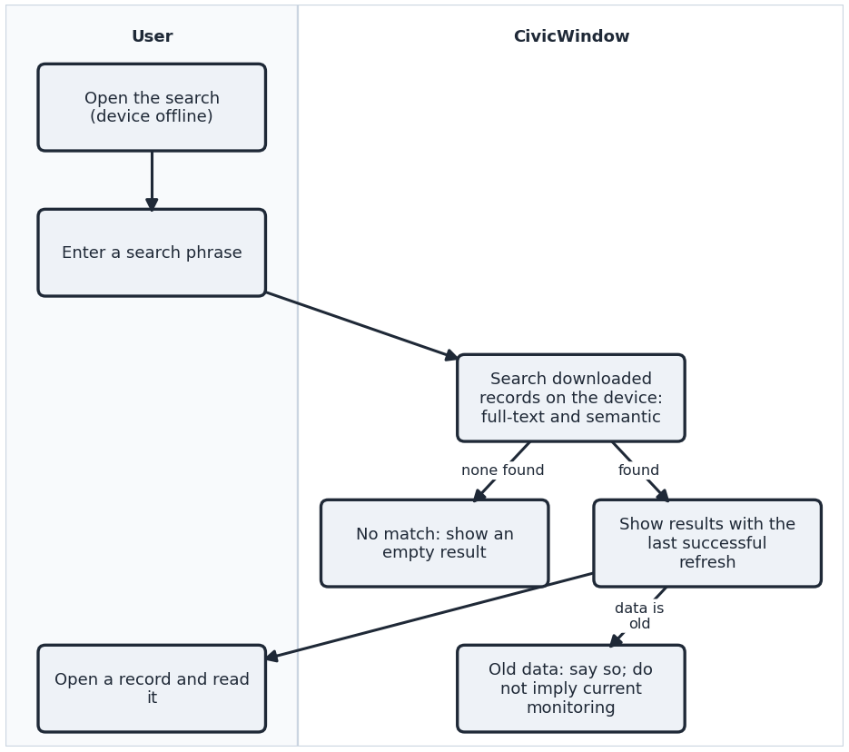

**Figure 8.** Flow of use case 7: search downloaded records offline.

#### 4.1.8. Use case 8: Delete all local data

**Stories covered:** A12.

**Preconditions:** CivicWindow holds local data: an interest profile, a jurisdiction selection or downloaded records.

**Main Flow:** (i) The user opens the local data screen (screen 9 in section 4.3). (ii) The screen says what CivicWindow keeps on the device. (iii) The user chooses to delete all local data. (iv) The application deletes the interest profile, the jurisdiction selection, the downloaded records and the earlier versions of them.

**SubFlows:**
- I. Data created by onboarding has a defined deletion path and is deleted with the rest.
- II. The user leaves the screen without choosing to delete: nothing is deleted.

Figure 9 shows the deletion path and the case where the user does not choose to delete.

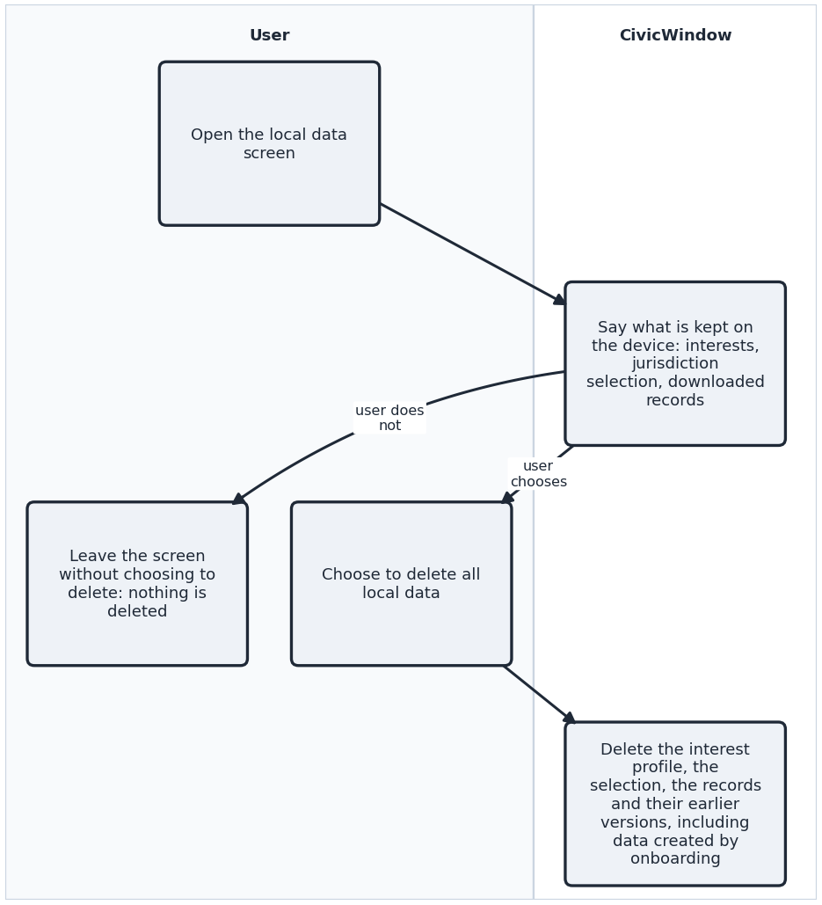

**Figure 9.** Flow of use case 8: delete all local data.

#### 4.1.9. Use case 9: Follow an additional jurisdiction

**Stories covered:** B1.

**Preconditions:** First-run setup is complete. A new connector has been added to the jurisdiction registry.

**Main Flow:** (i) The new connector is validated against the same access terms, authentication, rate limits, formats and repeatable retrieval as the first connectors. (ii) The jurisdiction joins the supported list. (iii) The user opens the jurisdiction screen. (iv) The application lists the new jurisdiction with the others. (v) The user selects it. (vi) The application keeps the selection on the device, and the next refresh retrieves its records (use case 2).

**SubFlows:**
- I. The connector fails validation: the jurisdiction is not advertised.
- II. The user disables retrieval for a source: the application retrieves nothing further from it.

Figure 10 shows how a jurisdiction that a new connector makes available reaches the user, and that an unvalidated source is never advertised.

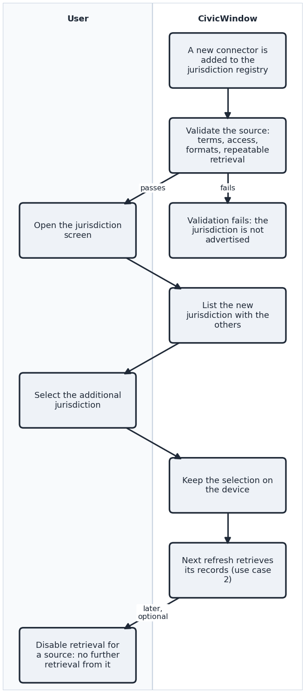

**Figure 10.** Flow of use case 9: follow an additional jurisdiction.

#### 4.1.10. Use case 10: See extracted entities, actions and deadlines

**Stories covered:** B2.

**Preconditions:** A record is downloaded. The extractor, a Category B model, is on the device.

**Main Flow:** (i) The on-device extractor reads the record text and metadata. (ii) It outputs entity strings, dates where supported, action labels, and evidence-span offsets or excerpts. (iii) The application checks each item against its evidence span in the retrieved record. (iv) The user opens the record. (v) The application shows the entities, actions and deadlines, each with its supporting excerpt. (vi) The user follows the official link to the source.

**SubFlows:**
- I. The record does not state an item: no value is invented.
- II. An excerpt does not match the retrieved record: the item is labeled uncertain or withheld, and the record stays inspectable.

Figure 11 shows that every extracted item is shown with its supporting excerpt and that missing information gets no invented value.

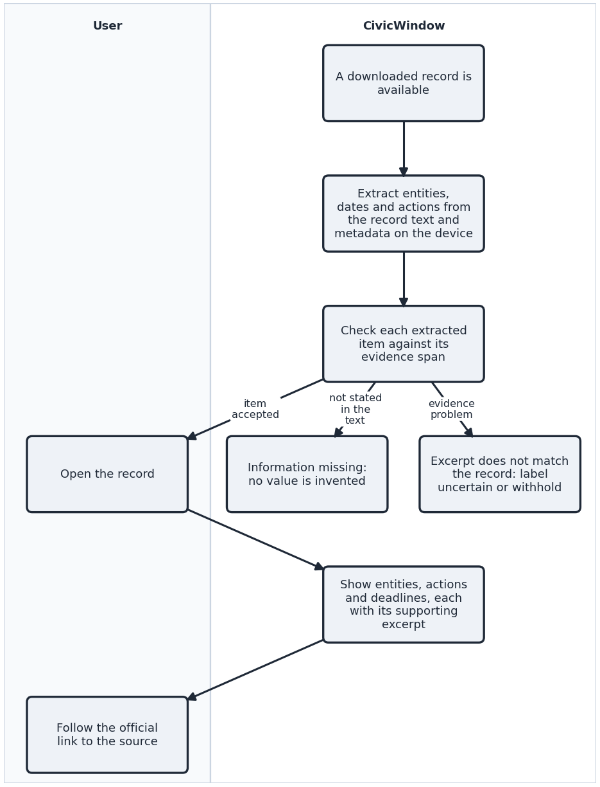

**Figure 11.** Flow of use case 10: see extracted entities, actions and deadlines.

#### 4.1.11. Use case 11: See document changes and version history

**Stories covered:** B3.

**Preconditions:** A document was downloaded earlier and is retrieved again in a later refresh.

**Main Flow:** (i) A refresh retrieves a document that is already stored. (ii) The application compares its content hash with the stored hash. (iii) When the hash differs, the application stores the new version and keeps the earlier one. (iv) The application marks the record as changed. (v) The user opens the version history of the record. (vi) The application shows the differences between the versions, and the user can follow the official link to the current document.

**SubFlows:**
- I. The hash is the same: no new version is stored.
- II. The source no longer serves the earlier version: the earlier version stays on the device until the user deletes local data (use case 8).

Figure 12 shows that a changed official document is kept as a new version beside the earlier one, never overwritten.

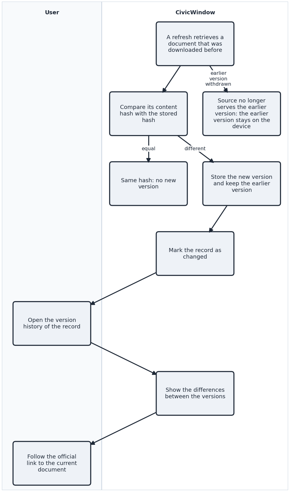

**Figure 12.** Flow of use case 11: see document changes and version history.

#### 4.1.12. Use case 12: Read a scanned agenda

**Stories covered:** B4.

**Preconditions:** A retrieved agenda is a PDF of scanned pages. The OCR component is on the device.

**Main Flow:** (i) A connector retrieves the agenda PDF. (ii) The application finds no extractable text in it. (iii) On-device OCR recovers headings, agenda numbers, tables, dates and paragraph structure. (iv) The application stores the recovered text with the record, and the record keeps its link to the original document. (v) The application classifies and matches the record as in use case 4. (vi) The user reads the recovered text and can compare it with the original through the official link.

**SubFlows:**
- I. The PDF has extractable text: OCR is not needed, and retrieval continues as in use case 2.
- II. The OCR result is unreliable: the application shows the uncertainty and keeps the official link.
- III. A source that needs OCR is not counted as a working core (Category A) connector; OCR belongs to this Alpha use case.

Figure 13 shows how a scanned agenda becomes text on the device, and that the record keeps its link to the original document.

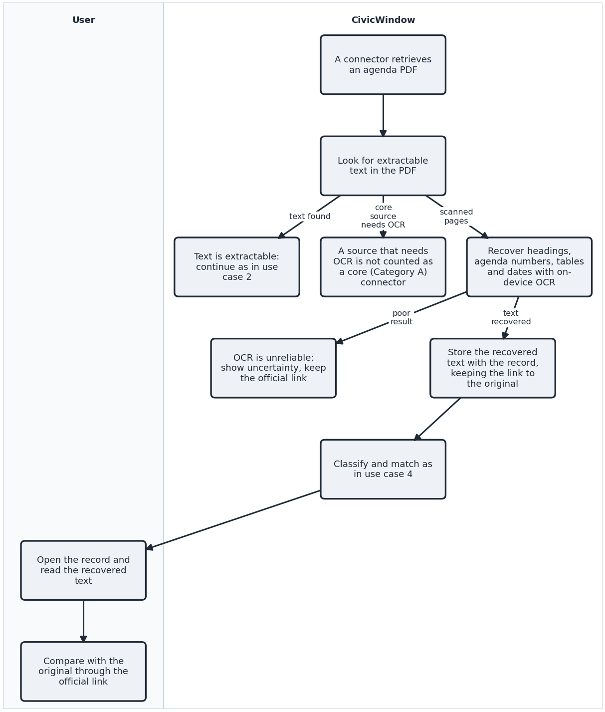

**Figure 13.** Flow of use case 12: read a scanned agenda.

#### 4.1.13. Use case 13: Filter results by geography and entity

**Stories covered:** B5.

**Preconditions:** Downloaded records exist. For the entity filter, the entities were extracted (use case 10).

**Main Flow:** (i) The user opens the discovery screen. (ii) The user filters the list by a geography (a jurisdiction or a radius) and by an entity (an agency, an organization or a project). (iii) The application applies the filter to the downloaded records on the device. (iv) The application shows the narrowed list and the filters in use.

**SubFlows:**
- I. No record matches: the application shows an empty result, which is not a failure.
- II. No network is needed: the filter works on downloaded records only.

Figure 14 shows the local filter, that it needs no network, and the empty result that is not a failure.

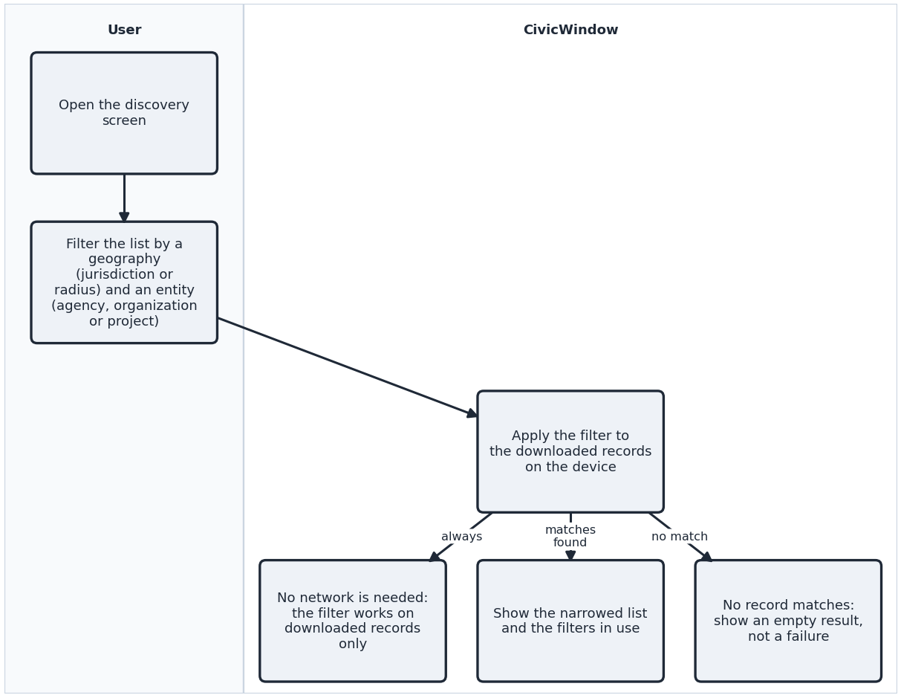

**Figure 14.** Flow of use case 13: filter results by geography and entity.

#### 4.1.14. Use case 14: Use the optional reasoning model

**Stories covered:** C1.

**Preconditions:** The core is established: core accuracy and mobile feasibility have been shown. The optional compact reasoning model is a Category C addition.

**Main Flow:** (i) The user chooses to use the optional reasoning model. (ii) The application downloads the model when a network is available. (iii) The application checks the device's memory and power limits and loads the model alone. (iv) The application produces a result from the record and its source evidence. (v) The application shows the result marked as model output, with its uncertainty and the source passage.

**SubFlows:**
- I. The device cannot load the model: the application says so, and the core features keep working.
- II. The user stops using the model: the core features are unchanged.

Figure 15 shows that the reasoning model is optional, is loaded only when the device allows, and that its output is kept apart from the source text.

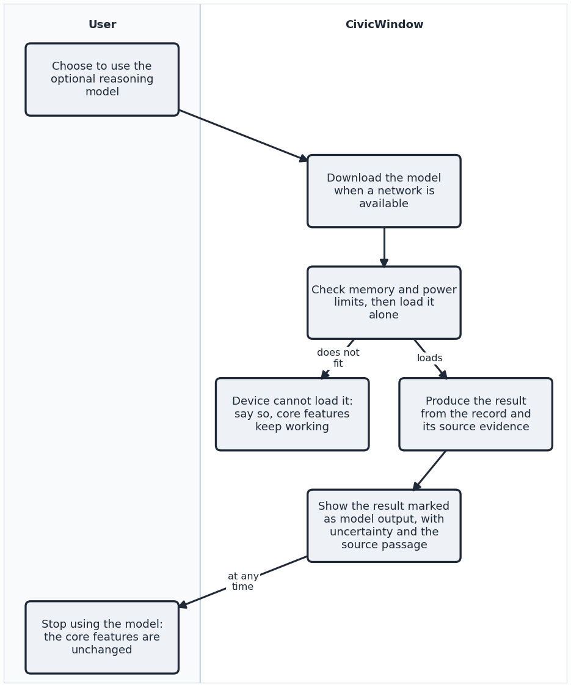

**Figure 15.** Flow of use case 14: use the optional reasoning model.

#### 4.1.15. Use case 15: Discover records in another language

**Stories covered:** C2.

**Preconditions:** A model for the added language is on the device.

**Main Flow:** (i) The user chooses an added language and writes an interest in it. (ii) The application keeps the interest on the device. (iii) The application classifies and matches records in that language with the on-device models. (iv) The application shows matched records with topic labels, uncertainty and the source excerpt. (v) The user opens a record and follows the official link.

**SubFlows:**
- I. The model for the language is missing: the application shows that state instead of an empty list.
- II. A record is in a language the application does not support: it stays unclassified and keeps its link.

Figure 16 shows classification and discovery in an added language, with the same uncertainty and missing-model states as in the first language.

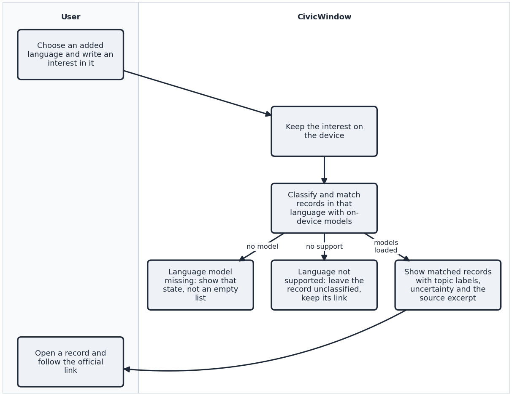

**Figure 16.** Flow of use case 15: discover records in another language.

#### 4.1.16. Use case 16: Add a connector through the community framework

**Stories covered:** C3.

**Preconditions:** The versioned connector interface and the shared connector tests exist. The contributor does not need access to any resident's data.

**Main Flow:** (i) A contributor writes a connector against the versioned connector interface. (ii) The contributor adds fixtures, expected records, the update cadence, license notes and automated health tests. (iii) The contributor opens a pull request. (iv) The shared connector tests and the health tests run. (v) A lead reviews the change and the source terms. (vi) When the connector is accepted, it enters the role branch and its registry entry is added, so the jurisdiction becomes available to users (use case 9).

**SubFlows:**
- I. The tests fail: the connector is not accepted, and the contributor revises it.
- II. The source terms are not validated: the connector is not added to the supported set.
- III. Contributions rest on code and evidence; none depends on uploading a resident's interest profile.

Figure 17 shows the path from a contributed connector to a jurisdiction the user can select, with the shared tests and the review in between, and the two cases that stop a connector or an upload.

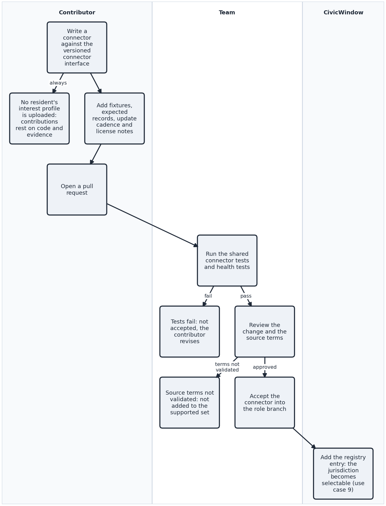

**Figure 17.** Flow of use case 16: add a connector through the community framework.

#### 4.1.17. Use case 17: View an enhanced evidence report or comparison

**Stories covered:** C4.

**Preconditions:** Records with their source evidence exist on the device.

**Main Flow:** (i) The user selects two or more records, or two versions of one record. (ii) The user chooses an evidence report or a comparison. (iii) The application builds it from labeled source text, source links and labeled model output. (iv) The application shows the report or comparison. (v) The user follows a source link to the official record.

**SubFlows:**
- I. A model output is uncertain: the report labels it as uncertain.

Figure 18 shows a report or comparison built only from labeled source text, links and model output.

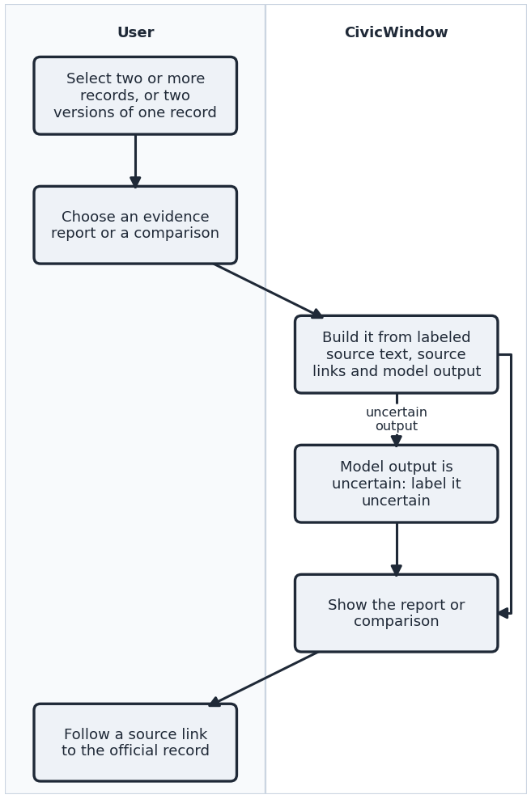

**Figure 18.** Flow of use case 17: view an enhanced evidence report or comparison.

### 4.2. User characteristics

The ideal user is a person who wants to follow local or state government activity without searching several portals. The primary audience is adults of about 25 to 65 who live in supported U.S. jurisdictions and actively follow local or state government activity. The proposed audience includes all genders and political affiliations. The age range is an initial research segment, not an eligibility limit and not a validated demographic finding; adults outside it may also use the application. User research will refine this audience.

Because the audience is broad, six user segments are identified. They are the primary user and the five secondary groups of the project's feasibility report. The third column restates what each segment is there to do, and the last column names the features of section 3.1 that serve that need. The project's pitch says that user research will refine the audience, and these two columns with it.

| Segment | Who they are | What they want | Features that serve it |
|---|---|---|---|
| 1. The resident | A resident who wants timely notice when a specific subject, such as a nearby development, transit change, utility proposal, park project, business permit or public hearing, appears in an official agenda or legislative record | To learn what matched, which official body published it, the relevant date or deadline, and the supporting source passage | Interests, discovery with evidence, notifications, manual refresh |
| 2. Local and student journalists | Local journalists and student journalists | Records they can trace to the official source and carry into their own analysis | Evidence-linked results, excerpts, Evidence Pack export |
| 3. Neighborhood and civic organizations | Neighborhood associations and nonpartisan civic organizations | To follow public proposals that affect their community | Interests, jurisdiction selection, notifications |
| 4. Small-business owners | Small businesses monitoring regulations, permits or public contracts | To notice proposals that affect their business | Interests, matched records, notifications |
| 5. Researchers | Researchers following a topic across several nearby jurisdictions | One view of a topic across more than one jurisdiction | Multi-jurisdiction retrieval, offline search, Evidence Pack export |
| 6. Privacy-minded residents | Residents who want civic information without a centralized behavioral profile | To keep interests, location and search history on their own device | Account-free onboarding, local interest profile, local data deletion |

**Users the product does not serve.** The first release does not target government staff authoring or approving official records; campaign targeting, voter persuasion, political advertising or partisan scoring; emergency alerting; a national replacement for every municipal website; or legal interpretation of legislation and advice about compliance.

### 4.3. User interface

This section plans the user interface. The interface designs are under development in a Figma design page, and the team submits its link with this document. The project documents describe the behaviors the interface must show, and they list the screen flows and accessibility states as decisions still to be made. The nine layouts below are proposed layouts, drawn for this document from those behaviors. They are not screenshots of another application, they are not wireframes, and they use no colors, fonts or wording beyond what is needed to show the behavior.

The interface is a native Android application built with Jetpack Compose. Nine screens cover the ten core (Category A) features, and Figure 28 shows how the user moves between them. Wherever a screen shows model output, it keeps the model's inference visibly apart from the source text and shows uncertainty, as the pitch requires. The accessibility states are decisions still to be made with the screen designs. The first ticket that adds a screen will carry an accessibility check, using the Compose test tools and the lint run, and the device check will cover the screen reader (the test strategy). The five refresh states must look different from one another, as the data flow requires.

**What the nine screens share, and where they differ.** The screens fall into three groups, as the screen map in Figure 28 shows: three first-run screens (1 to 3), four main screens (4, 5, 6 and 8) and two settings screens (7 and 9).

| Screen | Group | Statement it makes | Shows the last refresh | Its main action |
|---|---|---|---|---|
| 1 Welcome and privacy | First run | No account is needed; interests and records stay on the device | No | Continue |
| 2 Choose jurisdictions | First run | Matching happens on the device; only validated sources are listed | No | Next |
| 3 Your interests | First run | Interests are stored only on the device | No | Done |
| 4 Discovery | Main | Each item has its source status, dates, topic label and uncertainty, and why it matched | Yes, in the top bar | Refresh, or open a record |
| 5 Record and evidence | Main | Source text is kept apart from the model's inference; the source check does not prove the record correct | No (it shows when the record was retrieved) | Open the official source |
| 6 Refresh status and states | Main | Five distinct states, so a failure is never mistaken for “nothing new” | Yes | Refresh now |
| 7 Notifications | Settings | Timing is not guaranteed; records stay visible when notifications are off | Yes | The on and off switch |
| 8 Evidence Pack export | Main | The pack lists what it contains, with model outputs and uncertainty labeled | No | Choose where to save |
| 9 Local data | Settings | Everything CivicWindow keeps is on the device only | No | Delete all local data |

The screens are alike in four ways. Each carries a plain header or title and one main action. Each states on the screen the privacy or source rule that applies to it, in the same plain words (“on this device”, “only validated sources”, “source check”). The three screens that deal with refreshing (4, 6 and 7) all show the last successful refresh, so the user can always see how current the data is. And wherever a screen shows model output (4, 5 and 8), the output is labeled as such and uncertainty is shown, apart from the source text.

They differ in role and in shape. The first-run screens (1 to 3) are linear, with one forward button, and screens 2 and 3 are reached again from the bottom bar of discovery to change a choice. Discovery is the only screen with a list, a search field and a bottom bar, and it is the hub from which the user reaches every other main or settings screen. The record screen is the only one with two blocks, the source text and the model's inference, and the only one that opens the official source. The refresh status screen is the only one with five state banners. The notification screen is a settings screen with a switch and the state of Android's notification permission. The export screen is a form with a selection, a format and a place to save. The local data screen is the only one with a destructive action.

#### 4.3.1. Screen 1: Welcome and privacy

Figure 19 shows the welcome screen.

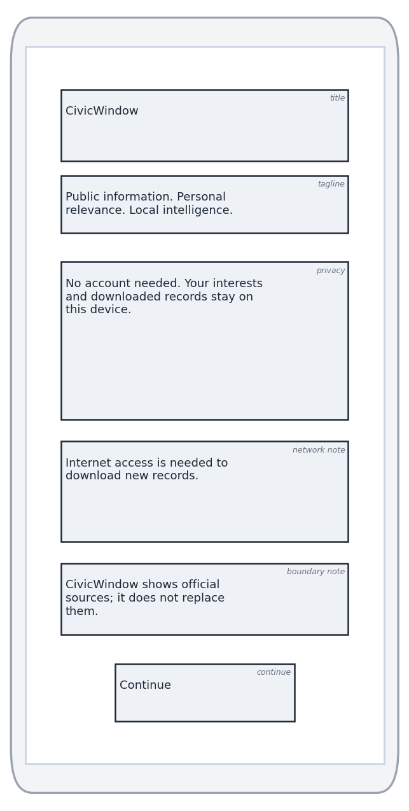

**Figure 19.** Proposed layout of the welcome screen.

*Why this image is relevant.* Figure 19 shows the account-free, private start. The first thing a new user sees must show that CivicWindow works without an account. The core experience needs no mandatory account, recurring subscription or hosted AI service, and interests and downloaded records stay on the device. The screen says this in plain words before asking for anything. It also states that internet access is needed for new records, so the user is not led to expect live monitoring. A single continue action keeps onboarding short, and nothing on the screen asks for personal details.

#### 4.3.2. Screen 2: Choose jurisdictions

Figure 20 shows the jurisdiction screen.

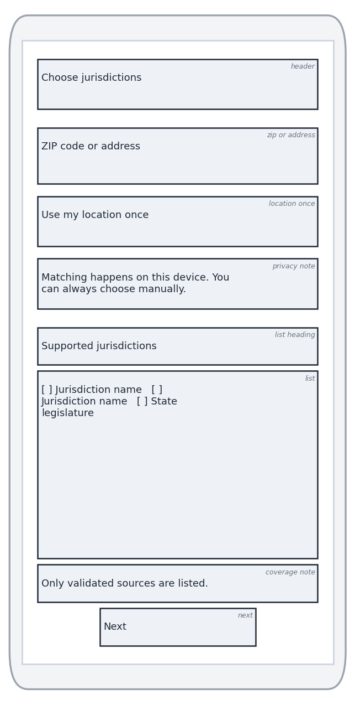

**Figure 20.** Proposed layout of the jurisdiction screen.

*Why this image is relevant.* Figure 20 shows private coverage selection with a manual path and only validated jurisdictions. The user chooses coverage privately. The screen offers a ZIP code or address, or one-time location access, and the matching happens on the device. If the user denies location permission, manual selection remains available, so the screen always has a manual path. The list shows only validated supported jurisdictions, because unsupported coverage must not be advertised. The selection is saved on the device, which is why the screen needs no sign-in.

#### 4.3.3. Screen 3: Your interests

Figure 21 shows the interest screen.

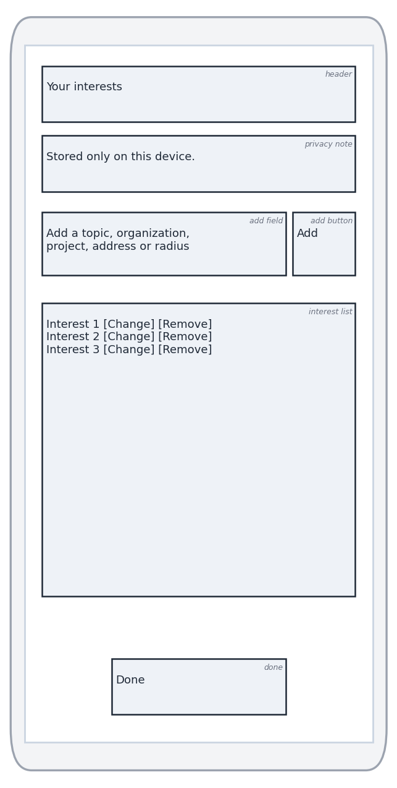

**Figure 21.** Proposed layout of the interest screen.

*Why this image is relevant.* Figure 21 shows the private interest profile that the on-device matcher uses. The interest profile is what the on-device matcher compares records against. The user chooses plain-language topics, organizations, named projects, addresses or geographic radii, and the screen says they stay on the device. The user can create and change interests, and the next ranking uses the changed profile. Showing the stored list makes the private profile visible to its owner.

#### 4.3.4. Screen 4: Discovery

Figure 22 shows the discovery screen.

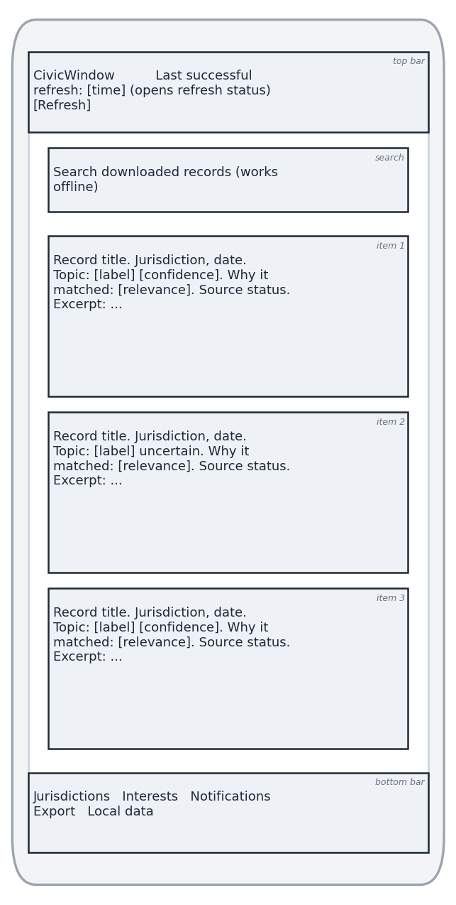

**Figure 22.** Proposed layout of the discovery screen.

*Why this image is relevant.* Figure 22 shows the main screen, with the matched records and the refresh status. This is the main screen: matched records, ranked by how well they match the user's interests. The pitch requires the source status and the dates on every result. Each item also shows a topic label with confidence or an uncertain mark and a short excerpt, together with the facts that a notification states in the feasibility report: its jurisdiction and the official body that published it, and why it matched the user's interests. The official link is on the record screen. The top bar shows the last successful refresh, which opens the refresh status screen, and a manual refresh action, so the user can see how current the list is. The bottom bar leads to the jurisdictions, interests, notifications, export and local data screens. A search field works on downloaded records without a network connection. The screen must never imply current monitoring when it shows old data.

#### 4.3.5. Screen 5: Record and evidence

Figure 23 shows the record screen.

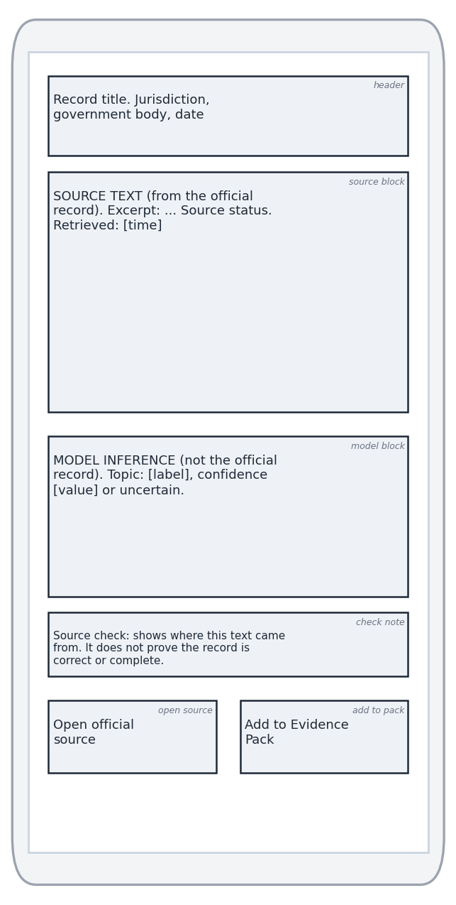

**Figure 23.** Proposed layout of the record screen.

*Why this image is relevant.* Figure 23 shows the source text kept apart from the model's inference, with uncertainty and the official link. Evidence-linked discovery is the product's central promise. The screen shows the source text in one block and the model's inference in a separate, labeled block, with uncertainty, so the user can tell what the official record says from what the AI concluded. The official link opens the authority, and the source check line states what it does and does not establish. The Evidence Pack holds selected records, so the record screen carries an action to add the record to a pack; where the user makes the selection is a screen-design decision still to be made.

#### 4.3.6. Screen 6: Refresh status and states

Figure 24 shows the refresh status screen.

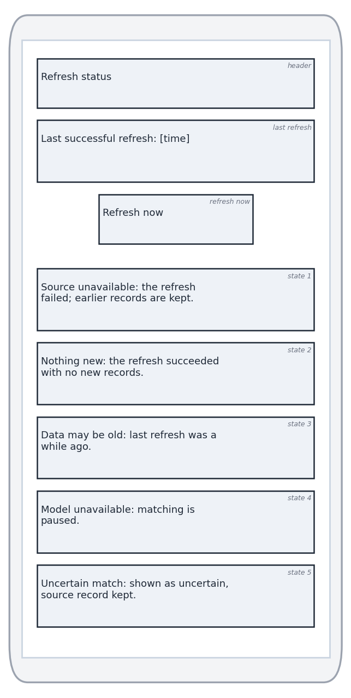

**Figure 24.** Proposed layout of the refresh status screen.

*Why this image is relevant.* Figure 24 shows the five distinct states the documents require. The documents require that a failed fetch, an empty successful result, stale local data, a missing model and an uncertain match look different from one another. This screen shows the last successful refresh, a manual refresh action, and one banner for each of those five states, so a failure is never mistaken for "nothing new". The wording of the banners, such as "matching is paused" for a missing model and "earlier records are kept" for a failed refresh, is a first draft: the project documents require only that these states are distinct. The screen also lets a user check how fresh the downloaded records are before relying on them.

#### 4.3.7. Screen 7: Notifications

Figure 25 shows the notification settings screen.

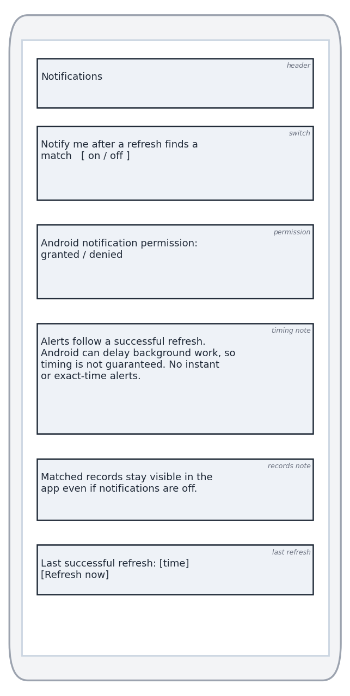

**Figure 25.** Proposed layout of the notification settings screen.

*Why this image is relevant.* Figure 25 shows optional notifications, the Android permission state and the statement that timing is not guaranteed. Notifications are optional and follow a successful retrieval and match. The screen has one switch to enable them and shows whether Android has granted the notification permission. It tells the user plainly that timing is not guaranteed: Android can delay background work, and CivicWindow promises neither instant nor exact-time alerts. Records stay visible in the application when notifications are off.

#### 4.3.8. Screen 8: Evidence Pack export

Figure 26 shows the export screen.

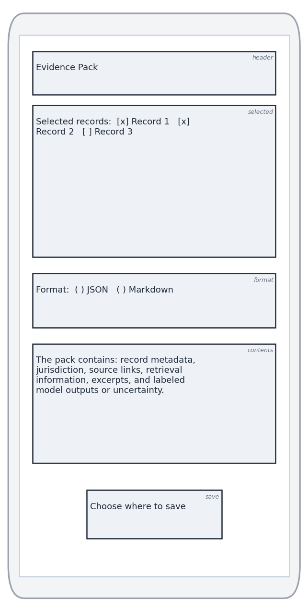

**Figure 26.** Proposed layout of the export screen.

*Why this image is relevant.* Figure 26 shows the user-directed export: selection, format, contents and where to save. The Evidence Pack is the user-directed way to take selected material out of the application. The screen lists the selected records, lets the user choose JSON or Markdown, and shows what the pack will contain: record metadata, jurisdiction, source links, retrieval information, excerpts and labeled model outputs or uncertainty. Saving uses the Android file chooser, so the user picks the place. The screen offers no sharing to a third-party AI service.

#### 4.3.9. Screen 9: Local data

Figure 27 shows the local data screen.

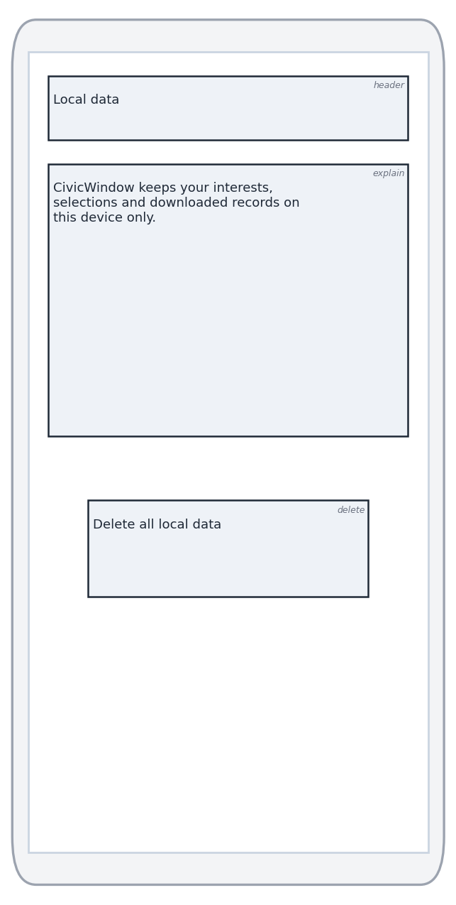

**Figure 27.** Proposed layout of the local data screen.

*Why this image is relevant.* Figure 27 shows the required full local-data deletion control. A full local-data deletion control is required, and onboarding data must have a defined deletion path. This screen gives the user one clear place to delete everything CivicWindow keeps on the device. The screen says what CivicWindow keeps on the device (the interest profile, the jurisdiction selection and the downloaded records). It supports the privacy promise: the user stays in control of the interests, selections and downloaded records.

#### 4.3.10. Screen map

Figure 28 shows the screen map.

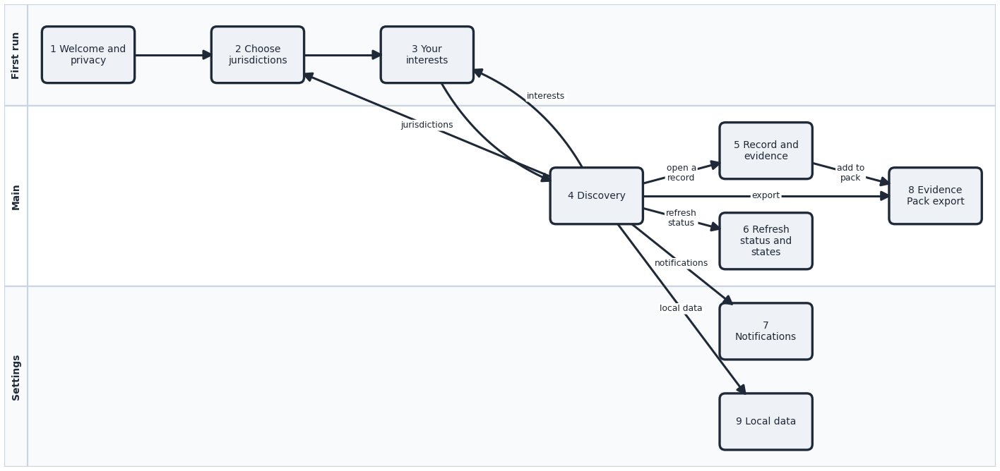

**Figure 28.** Proposed screen map.

*Why this image is relevant.* The map shows that the nine screens cover the core features. The welcome screen is the start of the first run and is not reached from discovery. The first run goes from the welcome screen to the jurisdiction and interest screens and then to discovery. From discovery the user opens a record, the refresh status, the notification settings, the export screen or the local data screen, and returns to the jurisdiction or interest screen to change a choice. From a record the user can go on to the export screen. Seven other screens are reachable from discovery (the jurisdiction, interest, record, refresh status, notification, export and local data screens), which keeps the navigation shallow. The links between the screens follow the order of the MVP experience in the feasibility report: coverage first, then interests, then discovery with its records, refresh status, notifications, export and local data. The final navigation structure is a screen-design decision still to be made, and the application's README asks that navigation be defined before another module is added to the app; it would keep the links in Figure 28.

## 5. Development Environment

### Developer Tools

The versions of Kotlin, Compose, Gradle, the Android Gradle Plugin (AGP), the JDK and the Android SDK levels are the baselines of the accepted decision records on the application stack, the build toolchain and the Android SDK levels: recent stable releases of November 2026, to be checked again at the first CI run after the repository is published. Three rows rest on weaker ground: the Python lock tool rests on a decision record that is still Proposed, and Git and PowerShell rest on the development guide's proposed baseline. No build has run yet, so none is confirmed by a build. AGP 9.3 pairs with Gradle 9.6, so those two are fixed together.

| Tool | Use | Version |
|---|---|---|
| Kotlin and Jetpack Compose | Android application and interface | Kotlin 2.4.21; Compose 1.12 line (UI, foundation, runtime 1.12.1) with Material 3 1.4.0, taken through the Compose Bill of Materials 2026.09.00, which maps to the 1.12 line |
| Gradle | Building the Android project and its modules | Gradle 9.6.0 with AGP 9.3.3 |
| JDK and Android SDK | Building Android code | JDK 17 (the minimum AGP 9.3 requires); Android SDK platform 37 (compile; the target level is 36), with build tools 36.0.0, the minimum and default of AGP 9.3 |
| Git, with a GitHub remote (the account and its rules are still open) | Version control with the branching workflow described in Production Plans | Git 2.56.1 (the development guide's proposed baseline) |
| PowerShell 7 | The baseline for setup scripts | PowerShell 7.6 LTS line (7.6.6 is its current release; the development guide's proposed baseline) |
| Python / ML environment | Model training, fine-tuning and reproducible evaluation in the development environment | Python 3.12, installed through uv, with the training libraries pinned in a lock file made by uv (the record for the lock tool is still Proposed) |
| LiteRT or ONNX Runtime Mobile | On-device inference, selected through compatibility testing | LiteRT 2.3 line, or ONNX Runtime Mobile (`onnxruntime-android`) 1.27.0 if testing favors it; the team would adopt one runtime, not both, unless testing shows a need |

The toolchain is Android Studio (a stable release that supports AGP 9.3; the exact version is open), the JDK, the Android SDK and Gradle above, on Windows 10 and 11 development machines, with PowerShell 7 for setup scripts, as the repository's coding standards and the decision record on the build toolchain state; other systems are added only if a member needs them. Setup records the exact versions of the runtime, Git, build tooling, JDK and Android SDK, and the Python/ML environment, so any member can reproduce the build.

### Content Generation Tools

The project documents state no content generation tools for the application. CivicWindow is a data and discovery application with no game assets. The interface designs are under development in a Figma design page (see 4.3), and diagrams are kept as text specifications that a rendering step turns into images, as this document's figures are.

### Data Tools

These data tools are planned; none is built yet.

| Tool | Use |
|---|---|
| Room / SQLite with full-text search | Local storage and offline search of downloaded records and interests |
| Compact local vector index | Local embeddings for semantic matching |
| Local data storage only | No cloud database and no CivicWindow server |

### 3rd Party Dependencies and APIs

The Android, WorkManager and Room rows are the baselines of the accepted decision records on the SDK levels and the application stack. The Legistar row follows the project's feasibility report, which describes the Legistar Web API as serving participating clients through paginated OData queries and says in general that municipal APIs can require tokens. The Open States row follows the Open States API documentation, and a feed or page is read as each jurisdiction publishes it. Each source would count as supported only after its access validation.

| Dependency | Use | Minimum and target version |
|---|---|---|
| Android | Target platform | Minimum API level 26 (Android 8.0); target API level 36 (Android 16), the level Google Play requires for new apps from 31 August 2026; compile API level 37 (Android 17) |
| Legistar Web API | Municipal legislative records | Read for participating clients through paginated OData queries; municipal APIs can require tokens |
| Open States / Plural Open API and bulk data | State legislative records | API version 3, with an API key; bulk downloads as the fallback |
| RSS / Atom feeds, HTML and PDF sources | Selected pilot jurisdictions | No version applies: RSS 2.0 and Atom 1.0 feeds, and HTML and PDF pages, would be read as each jurisdiction publishes them, and each connector would record the format it handled |
| WorkManager, Room | Background retrieval and local persistence | WorkManager 2.12.0; Room 2.8.5 |
| Candidate models: ModernBERT Base (classification), EmbeddingGemma 2 text-only (semantic matching); Qwen3 0.6B (optional, Category C) | On-device AI, subject to license review, compatibility testing and device benchmarks | Each model would be taken at the published checkpoint current when fine-tuning starts and fixed by its content hash in the model manifest; no checkpoint is chosen yet |

The platform is native Android only. No iOS version is proposed.

## Entity Relational Diagram

CivicWindow stores its data on the device, in a local database (Room / SQLite with full-text search and a compact local vector index), with no CivicWindow server. A relational design fits: records, meetings, agenda items, interests and match results refer to one another. The project's feasibility report suggests fifteen local tables, and Figure 29 draws them.

Figure 29 shows the proposed design. The fifteen table names come from the project's suggested local schema. A column appears only where a project document names that data element, such as a source URL, retrieval time or document hash, with two exceptions: the jurisdiction kind and the match status are proposals and are marked as such. The column names, types, keys and relations are proposals. The project documents state that the schema fields, types, migrations and versioning are still to be designed and finalized before validators are implemented. The fields, types, keys and migrations would be finalized in the order the documents set: the schema is designed and approved first, then the validators are written.

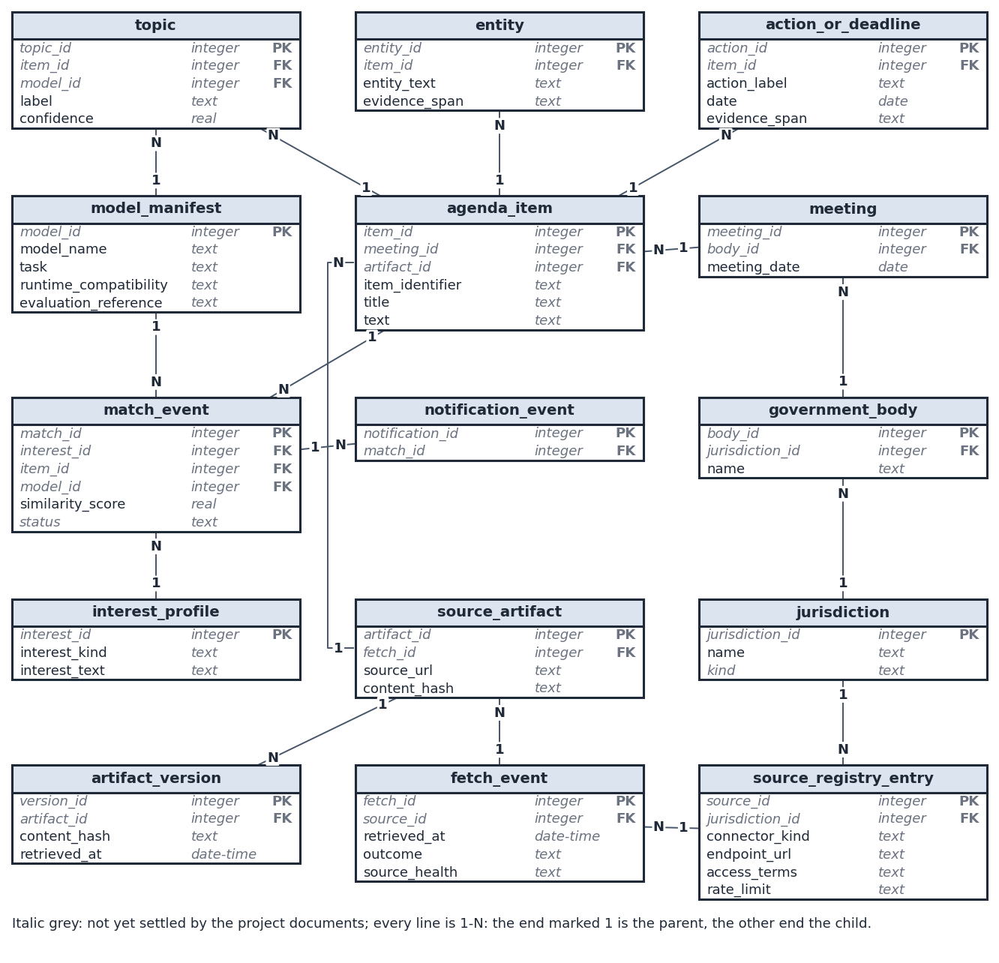

**Figure 29.** Proposed entity relational diagram of the local database (Room / SQLite).

In Figure 29, a column in italic grey is not yet settled by the project documents (the identifiers, the keys, the column types, the jurisdiction kind and the match status); each line between two tables is a one-to-many relation, with 1 at the table that has one and N at the table that has many.

**Where the indexes are stored.** The full-text index and the compact vector index are part of the same local database, as the feasibility report lists them with Room / SQLite, so both are stored on the device with the tables and need no server. The full-text index serves lexical search over the record text. The vector index holds the embeddings that the semantic matcher computes for records and for interests, so that search and ranking work offline on the downloaded records.

**Tables and Room entities.** Room is the access layer over SQLite. Each of the fifteen tables would be one Room entity, a Kotlin class that Room maps to the table, and the relations in Figure 29 would be foreign keys between those entities (Android's Room documentation).

The design keeps the raw artifact, the normalized record, the model output and the notification separately identifiable, so that a later correction does not alter historical evidence. When an official document changes, the application records the new content hash and keeps the earlier version rather than overwriting it.

| Table | Purpose in this design | Columns drawn |
|---|---|---|
| `jurisdiction` | A supported municipal or state government | name, kind (the kind is a proposal: the documents name municipal and state governments, not a column) |
| `government_body` | A council, board, commission or committee of a jurisdiction | name |
| `source_registry_entry` | A registered source and its connector, with its access terms | connector kind, endpoint URL, access terms, rate limit |
| `fetch_event` | One retrieval attempt with its time, outcome and the source's health | retrieved at, outcome, source health |
| `source_artifact` | A retrieved document with its source URL and content hash | source URL, content hash |
| `artifact_version` | A later version of an artifact, kept when the hash changes | content hash, retrieved at |
| `meeting` | A meeting of a body | meeting date |
| `agenda_item` | One agenda item or legislative matter, linked to its artifact as evidence | item identifier, title, text |
| `action_or_deadline` | A hearing, vote or deadline taken from an item (Category B extraction) | action label, date, evidence span |
| `entity` | A named agency, organization, project or location in an item (Category B extraction) | entity text, evidence span |
| `topic` | A topic label the classifier assigned to an item, with its confidence and model | label, confidence |
| `interest_profile` | An interest the user entered, stored only on the device | interest kind, interest text |
| `match_event` | A match between an interest and an item, with its score and status | similarity score, status (the status is a proposal: the documents describe an accepted, rejected or uncertain status for evidence validation, not a column on a match) |
| `notification_event` | A local notification posted for a match | none beyond its identifier and its link to the match |
| `model_manifest` | A model used on the device, its task, compatibility and evaluation reference | model name, task, runtime compatibility, evaluation reference |

Reading the relations: a jurisdiction has government bodies and registered sources; each source has fetch events, which yield artifacts; an artifact has versions and supports agenda items; a body holds meetings, which hold agenda items; an agenda item has actions, entities, topics and matches; an interest has matches; a match can lead to a notification; and a model manifest is referenced by the topics and matches it produced.

## 6. Production Plans

### Code Review Plan

**Requisites for Review**

*The course's plan:*

- All functionality is complete and working
  - Has been tested on end device
  - Needs no further revision
- Meets all coding standard requirements
- Functions are properly commented
- You will need to test as a team BEFORE Build Reviews.
- All completed work needs to be present on the Development branch unless there is a good reason for otherwise.

*How CivicWindow applies it.* The project's repository sets its own review rules, which this plan keeps:

- The branching policy says: “A ticket enters its role branch only when it is finished and reviewed.”
- The blueprint's role acceptance says: “Run the module's declared checks and validate relevant producer/consumer contracts. Review the exact ticket changes. Accepted work may enter its role branch.”
- The definition of done lists, for a role-accepted change, the required evidence: “Exact ticket change, declared behavior, relevant module/contract checks, documentation and review”.
- “Has been tested on end device” means a physical Android device: at least one designated tester must have access to one, and emulator-only results do not establish device readiness. Device access is a prerequisite to establish during kickoff, not an already confirmed resource.
- The repository's coding standards are stated as: “Shared engineering principles, with the decision record, the tool and the command that check each rule. No build or check has run yet: every check below is Proposed, and the first run is the first CI run after the repository is published.”
- The concrete rules are these. Kotlin and Android code would follow the official Kotlin coding conventions and Android's Kotlin style guide, formatted by ktlint and checked by Android Lint; detekt, which the decision record on the style also names, is added later. Python code would follow PEP 8, formatted and linted by Ruff. Gradle builds would use the Kotlin DSL with one version catalog for every dependency version. A change would pass the formatter and linters before review. The comment standard for “Functions are properly commented” is that every public function is commented, and each comment says what the function does and what it returns: a KDoc comment on every public Kotlin class and function, and a docstring on every public Python function, plus a short comment wherever the reason for the code is not obvious.
- The code owners file lists, for each area, its lead first and a backup reviewer second, so a lead's own pull request can still get a code-owner review. It is not yet in use: branch protections are not active until the repository is published.
- The pull request template asks for the linked issue, the branch and its baseline, the role, what changed, the checks run and which were not run, the contracts or schemas touched, what is not done yet, and a ready-to-merge list (finished, reviewed by a code owner, short, branch deleted). No pull request has used it yet.

### Integration Plan

**Source Control**

The course asks for the feature-branch workflow (Gitflow). The repository's branching policy does not use that name; it sets the rules below. The policy's state is: “Design rule; Git and remote branch protections are not active.” So the rules describe how CivicWindow will work, not a practice that already runs. They are quoted from the policy, with the policy's own “Provisional” marks kept. The policy plans one source repository for all branches and states: “Its permanent branches are `main` for approved production source, `dev` for integrated development, and `role/ai-ml`, `role/android`, `role/data-platform` for accepted work by the three leads.”

Figure 30 shows how a ticket branch reaches the role branches, `dev` and `main`, with the hotfix route and the update route.

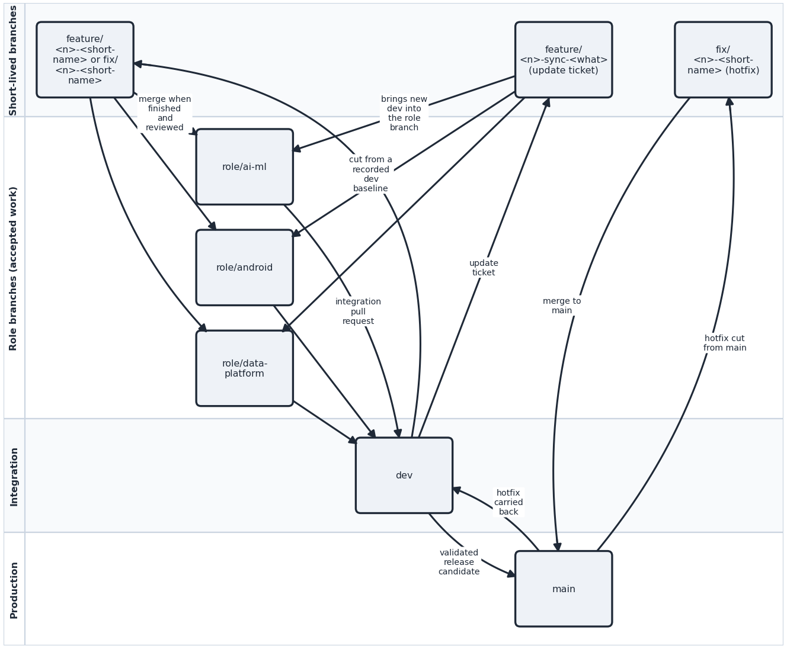

**Figure 30.** The branch flow: ticket branch, role branch, `dev`, `main`, with the hotfix route and the update route.

*When will branches be created?* A ticket branch is created for each ticket, from a recorded baseline on `dev`:

> **Names:** `feature/<n>-<short-name>` for new work and `fix/<n>-<short-name>` for a bug fix or a hotfix. The short name says what the ticket does, such as `feature/L101-meeting-summary-prompt`. Never name a ticket branch under a role branch, such as `role/ai-ml/...`: Git refuses it.

> **Base:** a ticket starts from a recorded integration baseline: the short commit id of the `dev` commit it was cut from, written in the ticket and the pull request. A ticket built on an unpromoted prerequisite names that prerequisite there too. Do not cut a ticket from a role branch's tip: the tip may hold other accepted tickets. Provisional.

> **Short:** one ticket, one branch, one merge, within the week of the ticket. Delete the branch after its merge. Split a ticket that cannot merge within the week. Provisional.

The repository's worktree guide gives the command: `git switch -c feature/L101-<short-name> --no-track origin/dev`, then `git rev-parse --short origin/dev`.

*When will they be merged?*

> 1. A ticket enters its role branch only when it is finished and reviewed.
> 2. After work reaches `dev`, each affected role branch gets the new `dev` through an update ticket and pull request, with applicability checked. Never force-reset a role branch. See Baseline synchronization.
> 3. Path: ticket, role branch, `dev`, `main`. A hotfix goes to `main`, then into `dev` and the affected role branches by the same update route.
> 4. Pull request keywords: a ticket's pull request into a role branch says “Refs #n”. The integration pull request into `dev` says “Closes #n”, because a closing keyword acts only on a merge into the default branch. Provisional.

For bug fixes the policy says: “Bug fixes are branches too. A bug in lane work uses `fix/` from a recorded baseline. A production hotfix uses `fix/` from `main`.” An update is an ordinary ticket: “`feature/<n>-sync-<what>` with the lead's own local number (provisional). Its pull request brings the new `dev` into the affected role branch and notes for each change whether it applies and what was checked.”

*What are the major branches?* `main` is the approved production source; `dev` is integrated development; and each lead has a role branch for accepted work: `role/ai-ml`, `role/android` and `role/data-platform`. A role branch is an acceptance lane, not an automatic production selection. The policy's list of permanent branches has no staging branch. The blueprint says a release candidate is an exact integration commit that gets validated before it reaches `main`, and that “a temporary branch, tag or equivalent mechanism can provide a convenient handle” for it.

The repository's integration policy (a design rule: no candidates, CI or pull request protections exist yet) sets how work reaches a release candidate: completed tickets are selected with their complete prerequisite set; a candidate identifies the exact source revision, the included tickets, the contract versions, the dependencies, the artifact digest, the checks and the reviewer's disposition; and a release candidate is one fixed source commit with a dependency manifest, which continued integration on `dev` must not change. No candidate has been made yet.

### Testing Plans

*The course's plan:*

**Weekly Code Reviews**

- The Day before Build Reviews with Mentor/Producer:
  - 1-2hrs - priority one
    - All team members will test all code completed during the work week
  - 15-30 min complete/incomplete discussion

**Bug Database**

- Maintained and updated by the team members
- Software: GitHub Issues, because the team's repository would be on GitHub and its pull request keywords already refer to issue numbers. The course template names Jira. The project documents plan an issue tracker instead: each ticket's work history lives in the issue, commits and pull requests, with no second manually synchronized backlog in Markdown. If the instructors ask for a Jira board, it is a copy made by hand from the GitHub issues.

**Outside Testing**

- Month 4 of Capstone
- 5 Testers selected
- Crosstesting will be expected on a monthly basis with other teams in CS and GD
- A Testing Report Compiled
  - Scenarios planned
  - Findings
  - Surprises
  - Planned Solutions

*How CivicWindow applies it.* The pitch plans Month 4 as Software Integration formal testing, with documented scenarios, results, reliability, performance, usability, accessibility and regression testing, and a findings report. The course's plan sets five outside testers and crosstesting with other teams; the five testers would be people outside the team, such as students from other teams, each given the same documented scenarios. The testers are not chosen yet, and their names are added when they are selected.

The repository's validation strategy sets what the team's own tests must cover. Role checks cover owned behavior and public contracts. Producer and consumer tests exercise both real implementations and controlled substitutes. Workflow tests cover fresh setup, selective ticket promotion and dirty-work preservation, and full integration tests use real selected modules. Device tests cover model loading, inference, offline search, retrieval recovery and notification permissions. The strategy also says: “A green test is evidence only for the property it would actually fail under a prohibited behavior.” Missing or unrun checks stay visible, and mocks cannot qualify a release.

The test libraries and the coverage tools are named in the repository's test strategy, and none has run yet. The decision record on the test libraries and coverage is still Proposed, so these choices are not yet accepted. Kotlin unit tests use JUnit 4 with Kotlin test assertions; controlled substitutes use MockK; flow and coroutine code uses Turbine and the kotlinx-coroutines test library; device tests use AndroidX Test and the Compose UI test libraries, and run by hand on a physical Android device, because the continuous integration jobs compile them and do not run them; Python tests use pytest. Coverage is measured and reported with no failing threshold: JaCoCo through the Android Gradle Plugin for Kotlin on Android, and pytest-cov for Python.

The continuous integration workflows are the automated part of this plan. The repository defines four workflows with seven jobs: the Android build, unit tests and static analysis; the Python checks; the commit-message checks; and the secret scan. None has run yet, and the first run is the first run in CI after the repository is published.

## 7. Folder Hierarchy

CivicWindow uses one source repository. Figure 31 shows where each lead's work is stored, so a new team member can see where the work happens. The tree is a target map: the folders and README files exist, but most source folders hold only a placeholder. The first build and application files exist: `app/src/main` holds a minimal application screen, `modules/android/discovery` holds its first screen and one device test, and `build-logic/` and `gradle/` hold the first build files. Library folders are not expanded.

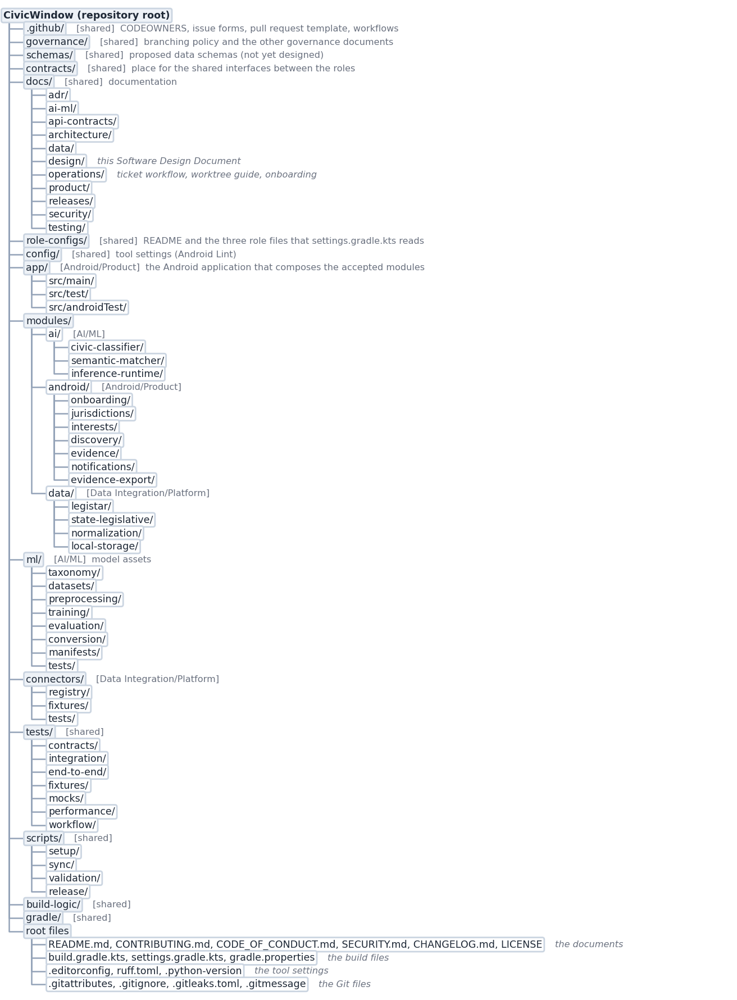

**Figure 31.** The repository folder hierarchy: where each lead works.

**Where each role works.** The AI/ML lead works in `modules/ai/` and `ml/`. The Android/Product lead works in `app/` and `modules/android/`. The Data Integration/Platform lead works in `modules/data/` and `connectors/`. All three share the foundation: `governance/`, `schemas/`, `contracts/` and `docs/`, together with the build and test support (`tests/`, `scripts/`, `role-configs/`, `config/`, `build-logic/` and `gradle/`).

- **`app/`** holds the Android application, which composes the accepted implementations through versioned shared interfaces.
- **`modules/`** holds the fourteen feature areas: three for AI (`civic-classifier`, `semantic-matcher`, `inference-runtime`), seven for Android (`onboarding`, `jurisdictions`, `interests`, `discovery`, `evidence`, `notifications`, `evidence-export`) and four for data (`legistar`, `state-legislative`, `normalization`, `local-storage`). The fourteen folders express ownership areas. They do not imply fourteen build modules.
- **`ml/`** holds the model assets: taxonomy, datasets, preprocessing, training, evaluation, conversion, manifests and tests.
- **`connectors/`** holds the connector registry, fixtures and tests.
- **`contracts/`** will hold the shared interfaces that let each role build against the others' agreed interface rather than their unfinished source; it has no sources yet. **`schemas/`** is the proposed place for the data schemas, which are still to be designed.
- **`governance/`** holds the governance documents, including the branching policy used in the Production Plans section. **`docs/`** holds the project documentation, including this document in `docs/design/`.
- **`tests/`** holds contract, integration, end-to-end, fixture, mock, performance and workflow tests. **`scripts/`** holds the setup, sync, validation and release scripts. **`build-logic/`** and **`gradle/`** hold the shared build support. **`config/`** holds shared tool settings, now the Android Lint configuration. **`role-configs/`** holds its README and the three role files (`ai-ml`, `android` and `data-platform`) that the Gradle settings file reads: each lists the Gradle projects that role builds. The exact role workspaces and build profiles are still to come.
- **`.github/`** holds the code owners file, the issue forms, the pull request template, the dependency-update settings and the workflow folder.
- The root holds the README, contribution guide, code of conduct, security note, changelog, license, the Gradle build and settings files, and the editor, Git, Python, lint and secret-scan settings. Generated output goes in a local `dist/` folder, which is not source and is ignored by Git.

**The Gradle projects.** The build has three Gradle projects so far: `:app`, `:modules:android:discovery` and `:contracts`. The other module folders are not Gradle projects; a module becomes one when its boundary can be tested on its own, and later modules follow the real dependency graph (the decision record on the module and build structure).

**Folders that Figure 31 leaves out.** Figure 31 stops at depth 3 below `app/` and `modules/`, and at depth 2 elsewhere: `docs/`, `ml/`, `connectors/`, `tests/` and `scripts/` show their subfolders, and the other top-level folders are drawn without subfolders. The folders it leaves out that hold files are: `.github/ISSUE_TEMPLATE/` and `.github/workflows/`; `config/lint/`; `gradle/wrapper/`; `build-logic/src/`; `app/src/main/kotlin/` and `app/src/main/res/`; `docs/design/figures/` and `docs/design/wireframes/`; the four folders of `tests/workflow/` (`candidate-selection`, `dependency-integrity`, `release-isolation` and `role-bootstrap`); `scripts/validation/tests/`; and the `src/main/` and `src/androidTest/` folders of `modules/android/discovery/`. Folders that hold only a placeholder file are left out and not listed.

The Gradle build files that the blueprint proposes at the root (settings, build and properties files) now exist, together with the wrapper settings and, in `gradle/`, one version catalog that holds every dependency version. The Gradle wrapper scripts and the lock and verification files are made at the first build, and no build has run yet. The build setup is Gradle with the Kotlin DSL, and the toolchain is the one in the Development Environment section: Gradle 9.6.0, Android Gradle Plugin 9.3.3 and JDK 17.

## AI Data Sets

CivicWindow's intended custom AI work is a civic topic classifier that is to be fine-tuned on the team's own taxonomy and labeled examples. A semantic matcher and, later, a structured extractor are planned to work with it. No acquired or labeled corpus is claimed in this proposal, and no model has been trained yet. This section shows the feature input and the result output of each, and which data set is planned to give these elements.

The classifier will read the text of a public record, such as an agenda item, together with details such as the jurisdiction and publication date, and will output the civic topics that fit the record, each with a confidence number. The matcher will turn the record text and the user's interest text into lists of numbers and compare them; the closer they are, the higher the record will rank for that interest. Local application logic will then combine the two results, apply confidence rules, check that the shown excerpt and link match the retrieved source, and flag uncertain results. That last step is ordinary program logic, not a trained model.

For each model, what it looks at, what it learns and what it outputs are:

- The model will look at the text of a public record and its metadata (the classifier), or at an interest description and a record's text (the matcher).
- It is intended to learn patterns such as the wording of agendas and notices that go with topics like zoning, transportation or utilities, and which interest descriptions fit which records.
- It will output topic labels with confidence scores (the classifier), or embedding vectors and a similarity score that ranks records (the matcher), based on the record text, its metadata and the user's interests.

| Model | Feature Vector (data types) | Result (datatype) | Data Set (include link) | Data Cleaning needed | Any Notes |
|---|---|---|---|---|---|
| Civic topic classifier (Category A) | Record text (UTF-8 string); record metadata as JSON, such as jurisdiction and publication date | Array of topic label strings with floating-point confidence scores | Public records from the Legistar Web API, Open States / Plural bulk data (https://open.pluralpolicy.com/data/), the Council Data Project (https://councildataproject.org/seattle/) and official municipal agenda portals | Deduplicate related records and document versions; check text quality; review source terms and rights; confirm or correct weak labels taken from source categories by human review; keep near-duplicates and related versions in the same partition | The corpus is not acquired yet. The target is at least 10,000 usable historical records, which is a raw-corpus target and not 10,000 labeled examples; thousands of usable input and output pairs are still needed (master pitch, Slide 7). Training, validation and a human-reviewed held-out test set will be kept apart, with chronological and jurisdiction hold-outs where coverage permits (master pitch, Slide 7; feasibility report, section 8). Evaluation will use precision, recall and macro F1 (master pitch, Slide 7) |
| Semantic matcher (Category A) | An interest description (UTF-8 string) and the record text (UTF-8 string) | Embedding vectors and a floating-point similarity score used to rank records | No existing data set: human-reviewed relevance judgments pairing interest descriptions with records, built from the public records above. No link yet: the data set is to be built | Include relevant, irrelevant and difficult near-match examples; source subject tags alone are not enough to label relevance | A pretrained embedding model is a candidate. It will be adapted or fine-tuned only if evaluation supports the effort. Evaluation will use retrieval precision at K (master pitch, Slide 7) |
| Structured extractor (Category B, later) | Record text (UTF-8 string) and structural metadata | JSON with entity strings, ISO-formatted dates where supported, action labels, and evidence-span offsets or excerpts | No existing data set: human-annotated entities, dates, action types and exact supporting spans. No link yet: the data set is to be built | Unavailable information will receive no invented value | Planned under Category B, after the core works. Evaluation will include evidence-span correctness (master pitch, Slide 7) |

Availability of a public record does not make it a labeled example: the source subjects and categories are candidate weak labels that reviewers are to confirm or correct, and low-confidence results are to be labeled uncertain or withheld from automated topic claims. Source terms must be recorded for every data set, because “publicly visible” does not automatically mean unrestricted redistribution.
